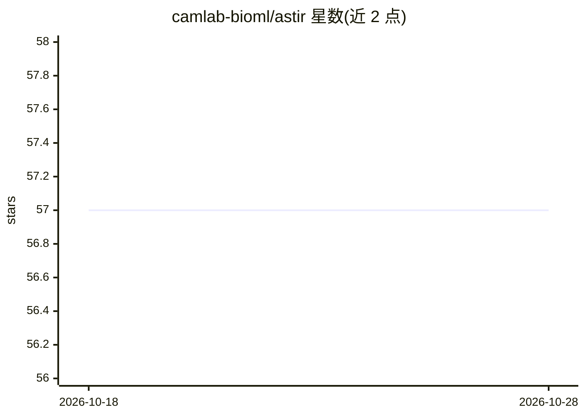

# camlab-bioml/astir

⭐ 59 · Python · GPL-2.0 · 推送 2026-09-02 · [GitHub](https://github.com/camlab-bioml/astir) · [官网](https://astir.readthedocs.io/en/latest) · 组织维护

**从单细胞多重成像与蛋白质组数据自动识别细胞类型的建模框架**

基于 PyTorch 的建模框架，面向成像质谱流式（IMC）等单细胞技术，用识别网络实现快速 minibatch 随机变分推断，自动分配细胞类型与状态。提供推断质量的诊断指标、用已有数据训练的识别神经网络将新数据映射到细胞类型/状态，以及绘图与数据加载工具。安装指引见官方文档（PyPI 发行为 v2.1），提供 Colab 交互式教程与文档。由 Lunenfeld-Tanenbaum 研究所与多伦多大学团队开发。

## 筛选速览

| 维度 | 判定 | 备注 |
|---|---|---|
| AI 角色 | `ai-native` | 本体是模型或模型工具 |
| 许可风险 | `viral` | GPL-2.0 |
| 部署形态 | `library` | 以包/库形式分发 |
| 模型依赖 | — | README 未给出锁定关系 |
| 硬件要求 | — | 无带数字的原话,不猜 |
| 安装摩擦 | `low` | 无编译、无系统依赖或容器化 |
| 成熟度 | — | 结构信号不足 |

## 能力要点

- 自动分配细胞类型与状态
- 识别网络将新数据映射到已训练的细胞类型/状态
- 推断质量的诊断指标
- 附带绘图与数据加载工具

## 适用场景

- 从高度多重成像/蛋白质组数据自动标注细胞类型
- 用已有标注数据训练后将新样本映射到细胞类型
- 检查细胞类型推断结果的质量

## 场景标签

 · 领域:生物信息学/单细胞分析

## 证据(README 行号)

> L12: ``astir`` is a modelling framework for the assignment of cell type across a range of single-cell technologies such 
> L16: - Automated assignment of cell type and state from highly multiplexed imaging and proteomic data

## 星数曲线

2026-10-18 57 → 2026-10-28 57（+0）

---
*卡片 v1 · prompt 1.4 · 生成 2026-10-24 · 置信度 mid · 依据 README sha `c2ce0baee58a` · [字段定义](../../DATASET.md)*
