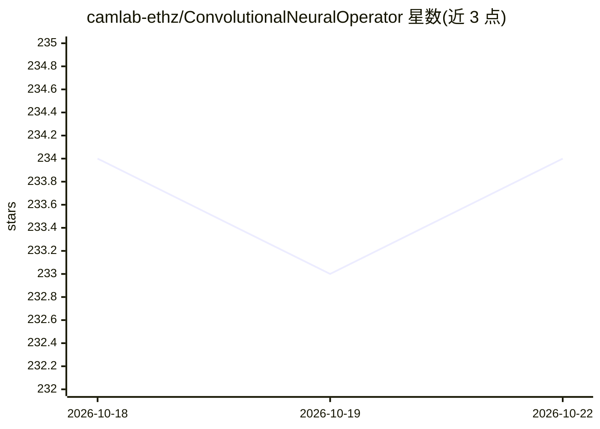

# camlab-ethz/ConvolutionalNeuralOperator

⭐ 234 · Python · MIT · 推送 2025-11-24 · [GitHub](https://github.com/camlab-ethz/ConvolutionalNeuralOperator) · [官网](https://arxiv.org/abs/2302.01178) · 组织维护

**Convolutional Neural Operator 的官方实现：用神经网络学习偏微分方程解**

NeurIPS 2023 论文 Convolutional Neural Operators for robust and accurate learning of PDEs 的官方代码库，由 ETH Cammarin 团组（camlab-ethz）维护。以卷积神经算子学习 Poisson、Wave、Navier-Stokes、Allen-Cahn、Transport、Compressible Euler 与 Darcy flow 等偏微分方程的解算，配套 Representative PDE Benchmarks（RPB）与数据集（约 2.4GB，Zenodo 或 download_data.py 下载）。仓库含 NeurIPS 2023 原版、vanilla CNO1d/CNO2d、Time-Dependent CNO 与 CNO 基础模型（109M 权重可下载）及基线模型代码，另覆盖 Poseidon 论文所用代码与 🤗 Hub 数据集。各版本安装说明位于各子目录 readme.md。

## 筛选速览

| 维度 | 判定 | 备注 |
|---|---|---|
| AI 角色 | `ai-native` | 本体是模型或模型工具 |
| 许可风险 | `permissive` | MIT |
| 部署形态 | `None` |  |
| 模型依赖 | — | README 未给出锁定关系 |
| 硬件要求 | — | 无带数字的原话,不猜 |
| 安装摩擦 | `medium` | 含编译或系统依赖之一 |
| 成熟度 | — | 结构信号不足 |

## 能力要点

- 提供 NeurIPS 2023 原版、vanilla、Time-Dependent 与 Foundation Model 多版本 CNO 代码
- 覆盖 Poisson/Navier-Stokes/Darcy flow 等 7 类 PDE 基准数据集（约 2.4GB）
- 提供 CNO-Foundation Model（109M）预训练权重下载与微调代码
- 在 Navier-Stokes 基准上给出不同测试分辨率下的误差对比

## 适用场景

- 科研人员复现论文中的 CNO 实验与基准
- 用神经算子求解偏微分方程做替代模型
- 在 RPB 基准上与基线模型对比误差

## 场景标签

`模型训练` · 领域:训练与推理

## 证据(README 行号)

> L3: - This repository is the official implementation of the paper **Convolutional Neural Operators for robust and accura
> L11: The CNO is tested on a novel set of benchmarks, termed as Representative PDE Benchmarks (RPB). The CNO is either on
> L42: We cover instances of the Poisson, Wave, Navier-Stokes, Allen-Cahn, Transport and Compressible Euler equations and 

## 星数曲线

2026-10-18 234 → 2026-10-22 234（+0）

---
*卡片 v1 · prompt 1.4 · 生成 2026-10-22 · 置信度 high · 依据 README sha `81e7127645c6` · [字段定义](../../DATASET.md)*
