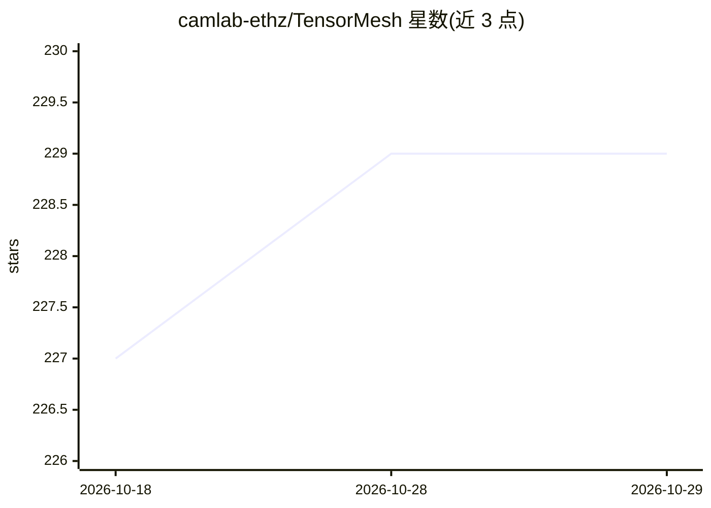

# camlab-ethz/TensorMesh

⭐ 229 · Python · Apache-2.0 · 推送 2026-10-20 · [GitHub](https://github.com/camlab-ethz/TensorMesh) · [官网](https://www.tensor-mesh.com/) · 组织维护

**基于 PyTorch 的可微分有限元库，供科研人员求解 PDE**

构建在 PyTorch 上的有限元方法（FEM）库：用纯 Python 编写弱形式，库负责张量化组装、稀疏线性代数、边界条件与时间积分，支持 GPU 加速与端到端自动微分，可实现逆问题、拓扑优化与物理约束的深度学习训练。支持三角/四面体/棱柱单元、Gmsh/VTK-HDF5 读写、Taylor-Hood 混合组装，求解器由配套库 torch-sla 提供（SciPy/PyTorch Krylov/cuDSS/STRUMPACK/PyAMG/AmgX 后端）。面向科研与工程仿真用户，是 TensorGalerkin 框架的 FEM 求解组件。

## 筛选速览

| 维度 | 判定 | 备注 |
|---|---|---|
| AI 角色 | `ai-enhanced` | 去掉 AI 部分产品仍成立 |
| 许可风险 | `permissive` | Apache-2.0 |
| 部署形态 | `library` | 以包/库形式分发 |
| 模型依赖 | — | README 未给出锁定关系 |
| 硬件要求 | — | 无带数字的原话,不猜 |
| 安装摩擦 | `medium` | 含编译或系统依赖之一 |
| 成熟度 | `idea` | |

## 能力要点

- 张量化 Map-Reduce 组装消除 Python 层循环，GPU 上单行 mesh.cuda() 迁移整个工作流
- 原生 autograd 贯穿组装与求解，支持逆问题与物理约束训练
- 无 JIT、eager 执行，纯 Python 弱形式无独立 DSL
- 多后端可微分稀疏求解器（含分布式多 GPU）

## 适用场景

- 用 PyTorch 语法求解 Poisson/Navier-Stokes/弹性力学等 PDE
- 通过 autograd 做逆设计与基于密度的拓扑优化
- 训练神经网络最小化 Galerkin 残差（physics-informed learning）
- 批量生成参数化 PDE 数据集供机器学习使用

## 场景标签

`科研工具` · 领域:学习与行业

## 证据(README 行号)

> L18: TensorMesh is a finite element method (FEM) library built natively on PyTorch.
> L133:  Inverse design — autograd through the FEM solve
> L187: |**Physics-informed**|`examples/physics_informed/`|Train a neural network to minimize the assembled Galerkin resid

## 星数曲线

2026-10-18 227 → 2026-10-29 229（+2）

---
*卡片 v1 · prompt 1.4 · 生成 2026-10-22 · 置信度 high · 依据 README sha `8cf6b606e8c5` · [字段定义](../../DATASET.md)*
