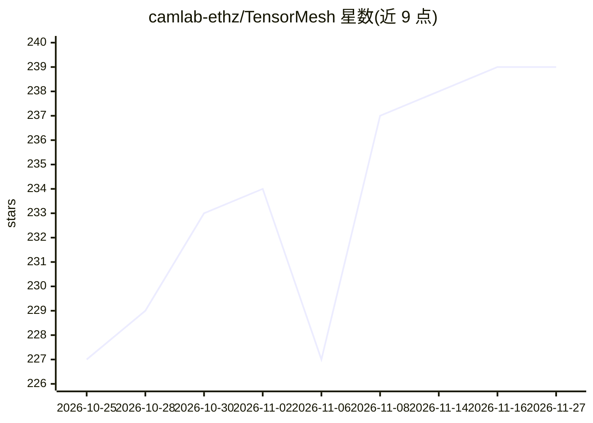

# camlab-ethz/TensorMesh

⭐ 239 · Python · Apache-2.0 · 推送 2026-11-21 · [GitHub](https://github.com/camlab-ethz/TensorMesh) · [官网](https://www.tensor-mesh.com/) · 组织维护

**基于 PyTorch 的可微分有限元求解库，面向 PDE 求解**

TensorMesh 是原生构建在 PyTorch 上的有限元方法（FEM）库，用于求解偏微分方程，提供自动微分、GPU 加速与即时执行的工作流。用户以纯 Python 编写弱形式，库负责张量化组装、稀疏线性代数、边界条件与时间积分；支持三角形/四面体/棱柱等单元与 Gmsh/VTK-HDF5/Exodus II 读写，稀疏求解经 torch-sla 在 SciPy、cuDSS、PyAMG、STRUMPACK、AmgX 等后端运行。通过 pip 安装，需 Python ≥3.10、PyTorch ≥2.0；示例以 Colab 笔记本提供，文档站点为 docs.tensor-mesh.com。

## 筛选速览

| 维度 | 判定 | 备注 |
|---|---|---|
| AI 角色 | `ai-native` | 本体是模型或模型工具 |
| 许可风险 | `permissive` | Apache-2.0 |
| 部署形态 | `library` | 以包/库形式分发 |
| 模型依赖 | — | README 未给出锁定关系 |
| 硬件要求 | — | 无带数字的原话,不猜 |
| 安装摩擦 | `medium` | 含编译或系统依赖之一 |
| 成熟度 | — | 结构信号不足 |

## 能力要点

- GPU 原生与端到端可微分：一行 mesh.cuda() 迁移工作流，autograd 穿透组装与求解
- 张量化 Map-Reduce 组装（TensorGalerkin），无 Python 层循环
- 纯 Python 弱形式 API，无需 DSL 与形式编译器，即时执行免 JIT
- 支持 Taylor-Hood 多场混合组装与 Bloch-Floquet 周期边界

## 适用场景

- 求解 Poisson、Stokes、Navier-Stokes、波动方程等 PDE 正问题
- 通过 autograd 做逆问题与逆设计（系数场辨识、拓扑优化）
- 训练神经网络最小化 Galerkin 残差的物理信息学习
- 批量生成 PDE 数据集用于机器学习训练

## 场景标签

 · 领域:科学计算/数值模拟

## 证据(README 行号)

> L18: TensorMesh is a finite element method (FEM) library built natively on PyTorch.
> L28: - **GPU-native & differentiable.** Built on PyTorch from the ground up. Moving an entire FEM workflow to the GPU ta

## 星数曲线

2026-10-25 227 → 2026-11-27 239（+12）

---
*卡片 v1 · prompt 1.4 · 生成 2026-11-25 · 置信度 high · 依据 README sha `8983d3a32b73` · [字段定义](../../DATASET.md)*
