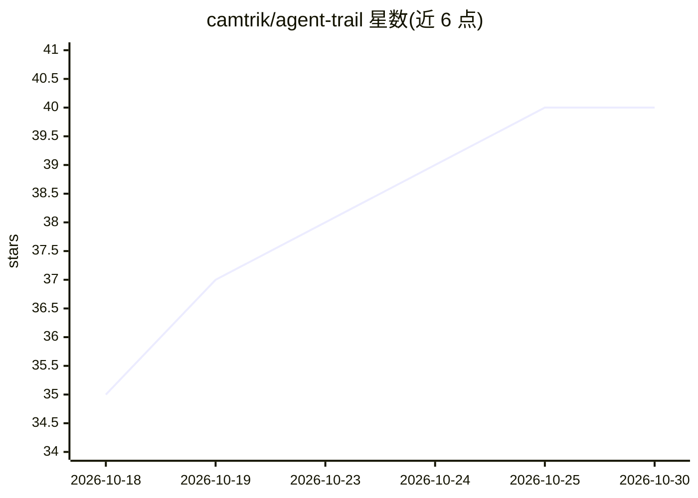

# camtrik/agent-trail

⭐ 40 · TypeScript · 推送 2026-06-24 · [GitHub](https://github.com/camtrik/agent-trail) · [官网](https://camtrik.github.io/agent-trail/) · 个人维护 · 中文 README

**本地 AI 编码 agent 会话观测面板：token/成本/回放**

面向 Claude Code、Codex、OpenCode、OpenClaw、Qoder 用户的本地观测面板：读取各 agent 在本地生成的 JSONL/SQLite 会话文件，聚合 token 用量与估算成本（按天/会话/项目/模型分解），支持逐轮次回放会话、展开工具调用参数与输出、渲染子 agent 嵌套树、按轮次统计 token，并内置 local-session-search 技能让编码 agent 通过本地 API 检索历史会话。提供 npm 全局安装、Docker 镜像与源码运行三种方式，数据全程本地，面板只读不重执行工具调用。

## 筛选速览

| 维度 | 判定 | 备注 |
|---|---|---|
| AI 角色 | `ai-ecosystem` | LLM/agent 周边工具 |
| 许可风险 | `none` | — |
| 部署形态 | `self-host` | docker 或自建部署 |
| 模型依赖 | — | README 未给出锁定关系 |
| 硬件要求 | — | 无带数字的原话,不猜 |
| 安装摩擦 | `low` | 无编译、无系统依赖或容器化 |
| 成熟度 | — | 结构信号不足 |

## 能力要点

- 聚合多 agent 的 token 用量与估算成本，按项目/模型/时间分解
- 逐轮次会话回放：工具调用、子 agent 树、注入上下文、轮级 token 计量
- 内置 local-session-search agent 技能，支持全局消息体检索历史会话
- 支持 5 种 AI 编码 agent，含 SQLite（OpenCode）与本地缓存 DB（Qoder）来源

## 适用场景

- 查看多个 AI 编码 agent 的 token 花费去了哪里
- 逐轮回放调试昂贵或失败的编码 agent 会话
- 让编码 agent 搜索并定位我的历史会话
- 追踪 Claude Code 的工具调用与子 agent 委派过程

## 场景标签

`LLM 可观测性` · 领域:评测与运维

## 证据(README 行号)

> L5: **A local AI coding agent observability dashboard for Claude Code, Codex, OpenCode, OpenClaw, and Qoder.**
> L7: Track token usage, estimated cost, tool calls, subagent trees, and replay full coding-agent sessions from local JSON

## 星数曲线

2026-10-18 35 → 2026-10-30 40（+5）

---
*卡片 v1 · prompt 1.4 · 生成 2026-10-25 · 置信度 high · 依据 README sha `29b685a9f6d9` · [字段定义](../../DATASET.md)*
