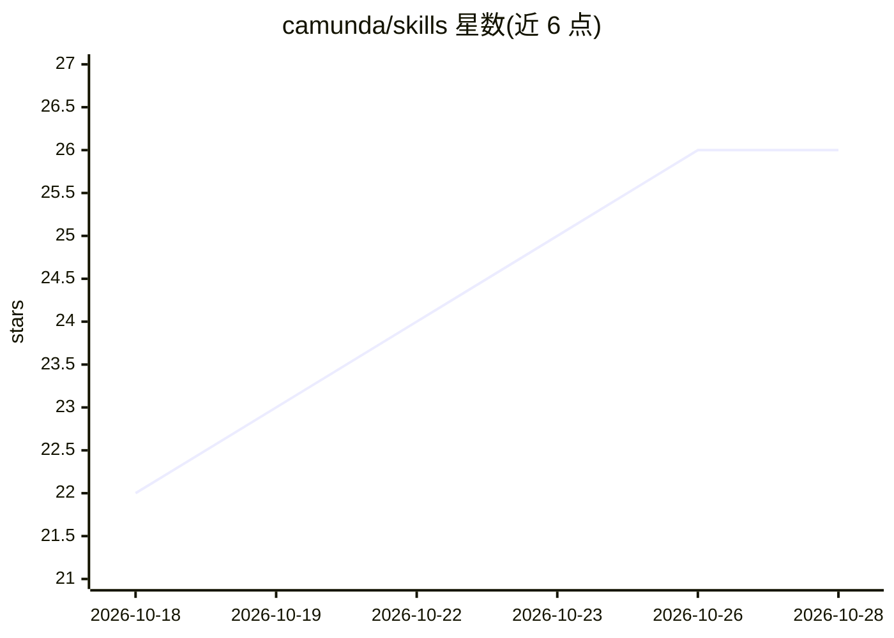

# camunda/skills

⭐ 26 · Python · Apache-2.0 · 推送 2026-10-26 · [GitHub](https://github.com/camunda/skills) · [官网](https://camunda.com) · 组织维护

**Camunda 8 官方 AI 编程技能包，供 Agent 构建 Camunda 解决方案**

Camunda 维护的 AI coding skills 仓库，遵循 Agent Skills 开放标准（SKILL.md + YAML frontmatter），提供 12 个覆盖 c8ctl 配置、BPMN/DMN/FEEL 编写、连接器开发、流程测试与 AI Agent 构建的技能包。技能可被 Claude Code、GitHub Copilot CLI 及任意 Agent Skills 兼容运行时发现和加载；命令执行与凭证由宿主环境承担。README 标注为 technical preview，处于重度开发中，附兼容性审计矩阵与可移植性声明。

## 筛选速览

| 维度 | 判定 | 备注 |
|---|---|---|
| AI 角色 | `ai-ecosystem` | LLM/agent 周边工具 |
| 许可风险 | `permissive` | Apache-2.0 |
| 部署形态 | `library` | 以包/库形式分发 |
| 模型依赖 | — | README 未给出锁定关系 |
| 硬件要求 | — | 无带数字的原话,不猜 |
| 安装摩擦 | `medium` | 含编译或系统依赖之一 |
| 成熟度 | `idea` | |

## 能力要点

- 12 个官方技能覆盖 c8ctl、BPMN、DMN、FEEL、连接器、流程测试等 Camunda 8 开发任务
- 遵循 Agent Skills 开放标准，同一包格式可被多种宿主（Claude Code、Copilot CLI 等）发现
- 含 compatibility/audit.json 审计基线与 skills-index.json 机器可读清单，make compatibility-check 校验一致性
- 通过 npx skills add、Claude/Copilot 插件市场或 git clone 多途径安装

## 适用场景

- 用 AI 编程助手快速搭建 Camunda 8 流程与集成方案
- 让 Claude Code / Copilot CLI 生成并校验 BPMN、DMN、表单文件
- 查询官方文档、部署资源与排查流程实例（经 c8ctl）

## 场景标签

`提示工程` · 领域:Agent 开发

## 证据(README 行号)

> L6: Official AI coding skills for Camunda 8 development. Build working Camunda solutions in minutes with AI guidance.
> L8: These skills use the Agent Skills open standard. The package format is a skill directory containing `SKILL.md` with 

## 星数曲线

2026-10-18 22 → 2026-10-28 26（+4）

---
*卡片 v1 · prompt 1.4 · 生成 2026-10-26 · 置信度 high · 依据 README sha `6a0b516adeeb` · [字段定义](../../DATASET.md)*
