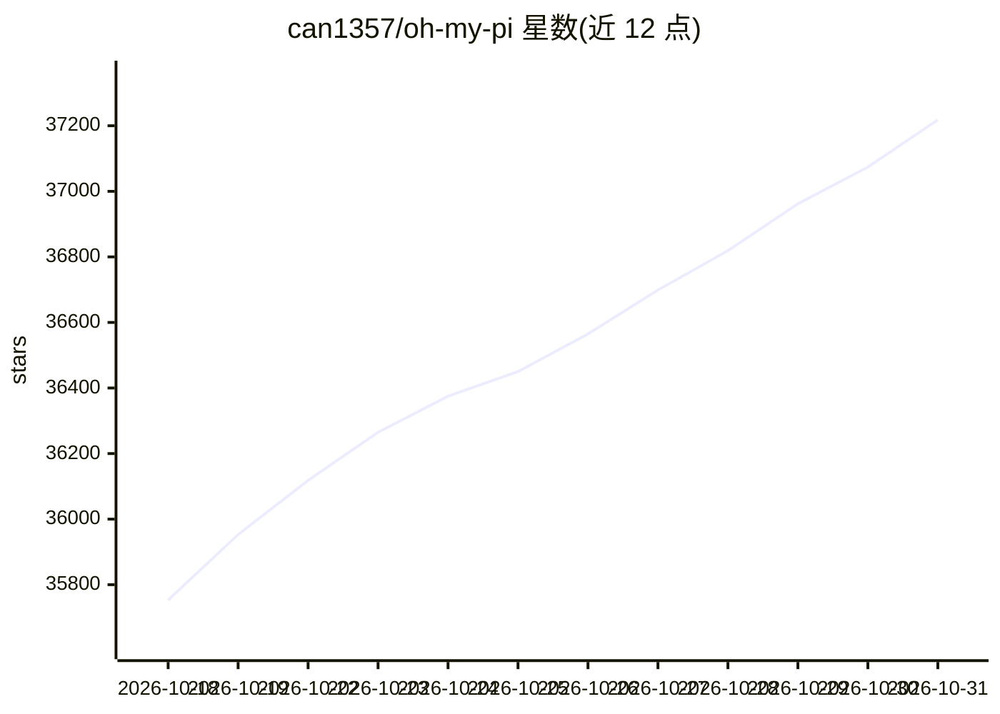

# can1357/oh-my-pi

⭐ 37,218 · TypeScript · MIT · 推送 2026-10-30 · [GitHub](https://github.com/can1357/oh-my-pi) · [官网](https://omp.sh) · 组织维护

**面向开发者的 IDE 级编码 agent CLI，60+ 模型接入**

Stencil Labs 维护的 Pi 分叉，以 CLI/TUI 形式提供编码 agent：内置 31 个工具、14 个 LSP 操作、28 个 DAP 调试操作，Rust 核心约 8 万行。支持 60+ 模型提供方，接入 lldb/dlv/debugpy 等调试器，提供子代理 fan-out（隔离 worktree、schema 校验返回）、reviewer 模型逐轮监督、流中规则注入、/collab 会话共享、按内容哈希的编辑（hashline）与基于 git 的原子提交拆分。安装覆盖 curl 脚本、Homebrew、Bun、Nix、Windows PowerShell、mise。PR 接受采用 vouch 机制（当前暂停试用中）。

## 筛选速览

| 维度 | 判定 | 备注 |
|---|---|---|
| AI 角色 | `ai-native` | 本体是模型或模型工具 |
| 许可风险 | `permissive` | MIT |
| 部署形态 | `library` | 以包/库形式分发 |
| 模型依赖 | — | README 未给出锁定关系 |
| 硬件要求 | — | 无带数字的原话,不猜 |
| 安装摩擦 | `low` | 无编译、无系统依赖或容器化 |
| 成熟度 | — | 结构信号不足 |

## 动量与使用信号

- 维护:`active` — 距上次 push 0.7 天,年发版 100,404 位贡献者
- 涨星:近 1 天 **+138**(自 20261016 起算)
- 下载:GitHub Release 附件 累计 1,574,014(100 个 release)
- 平台:WINDOWS / MACOS / LINUX · 协议:OPENAI-API / MCP / OLLAMA

## 能力要点

- 60+ 模型提供方、31 内置工具、14 LSP 操作、28 DAP 操作
- 持久 Python/Bun 执行内核可回调 agent 工具
- 子代理在隔离 worktree 并行，返回 schema 校验结果
- 通过 ACP 在 Zed 中驱动同一 agent，无需插件

## 适用场景

- 在终端用所选模型驱动具备 IDE 能力（LSP/调试器）的编码 agent
- 把任务拆给多个子代理并行完成并汇总结果
- 与同事共享 agent 会话进行结对或观摩
- 让 agent 生成原子化 git 提交序列

## 场景标签

`编码 Agent` `多智能体` · 领域:Agent 开发

## 证据(README 行号)

> L3:  A coding agent with the IDE wired in.
> L19: **60+** providers · **31** built-in tools · **14** lsp ops · **28** dap ops · **~80k** lines of Rust core.
> L15:  Built by Stencil Labs · Fork of Pi by @mariozechner

## 星数曲线

2026-10-18 35,753 → 2026-10-31 37,218（+1,465）

---
*卡片 v1 · prompt 1.4 · 生成 2026-10-18 · 置信度 mid · 依据 README sha `e1a795ae93b0` · [字段定义](../../DATASET.md)*
