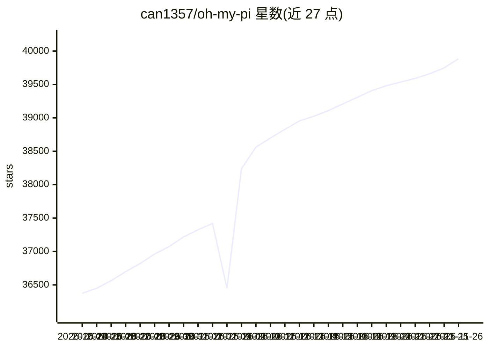

# can1357/oh-my-pi

⭐ 39,886 · TypeScript · MIT · 推送 2026-11-25 · [GitHub](https://github.com/can1357/oh-my-pi) · [官网](https://omp.sh) · 组织维护

**给开发者的集成 IDE 能力的终端编码 Agent**

由 Stencil Labs 维护的终端编码 Agent（Pi 的 fork），以 CLI/TUI 形式运行，内置 31 个工具、60+ 模型提供商接入、LSP 与 DAP 操作。机制上把 LSP 重命名、调试器（lldb/dlv/debugpy）、子代理 fan-out、流中规则注入、advisor 第二模型审阅、会话共享链接、内容哈希编辑（Hashline）、GitHub PR 即文件读取、跨会话记忆等功能并入同一工具面，支持 ACP 在 Zed 中驱动，可读取 Cursor/Cline/Codex 等已有配置格式。安装覆盖 macOS/Linux/Windows 及 bun/Nix/Homebrew/mise。

## 筛选速览

| 维度 | 判定 | 备注 |
|---|---|---|
| AI 角色 | `ai-ecosystem` | LLM/agent 周边工具 |
| 许可风险 | `permissive` | MIT |
| 部署形态 | `library` | 以包/库形式分发 |
| 模型依赖 | — | README 未给出锁定关系 |
| 硬件要求 | — | 无带数字的原话,不猜 |
| 安装摩擦 | `low` | 无编译、无系统依赖或容器化 |
| 成熟度 | — | 结构信号不足 |

## 动量与使用信号

- 维护:`active` — 距上次 push 0.7 天,年发版 100,404 位贡献者
- 涨星:近 1 天 **+138**(自 20261016 起算)
- 下载:GitHub Release 附件 累计 1,574,014(100 个 release)
- 平台:WINDOWS / MACOS / LINUX · 协议:OPENAI-API / MCP / OLLAMA

## 能力要点

- 内置 31 个工具、60+ 提供商、14 个 LSP 操作与 28 个 DAP 操作
- LSP 写入：重命名走 workspace/willRenameFiles，联动更新 barrel 文件与别名导入
- 可驱动真实调试器：lldb、dlv、debugpy 附加进程
- 子代理 fan-out 输出 schema 校验的结构化结果，并带 Agent Hub 监控

## 适用场景

- 在终端里让 Agent 直接完成重命名、编辑、重构等代码修改
- 让 Agent 附加调试器定位 segfault 或挂起的进程
- 用 /review 对分支或提交做 P0-P3 分级代码评审
- 通过 /collab 链接让队友只读或共同操作同一 Agent 会话

## 场景标签

`编码 Agent` `代码审查` · 领域:编码与开发

## 证据(README 行号)

> L3:  A coding agent with the IDE wired in.
> L21: **60+** providers · **31** built-in tools · **14** lsp ops · **28** dap ops · **~80k** lines of Rust core.

## 星数曲线

2026-10-24 36,375 → 2026-11-26 39,886（+3,511）

---
*卡片 v1 · prompt 1.4 · 生成 2026-11-26 · 置信度 mid · 依据 README sha `1eb701a8aa2f` · [字段定义](../../DATASET.md)*
