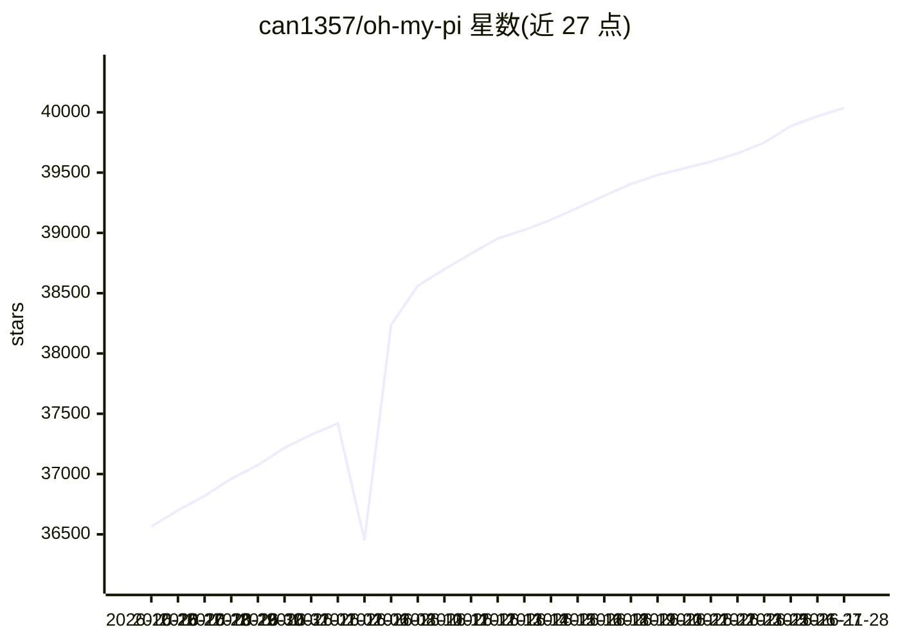

# can1357/oh-my-pi

⭐ 40,036 · TypeScript · MIT · 推送 2026-11-27 · [GitHub](https://github.com/can1357/oh-my-pi) · [官网](https://omp.sh) · 组织维护

**CLI 编码 agent：把 IDE 能力接入 agent 循环**

由 Stencil Labs 维护的终端编码 agent（Pi 的分支），以 Rust 核心（约 8 万行）加 TypeScript 构成，含 31 个内置工具、14 个 LSP 操作与 28 个 DAP 操作。功能包括：持久 Python/Bun 执行内核可通过回环桥调用 agent 工具、写操作走 LSP（如 willRenameFiles 触发引用更新）、驱动 lldb/dlv/debugpy 等调试器、流中正则规则注入纠偏、子代理在隔离 worktree 并行产出 schema 校验结果、advisor 模型逐轮旁路审阅、/collab 会话共享链接与二维码、hashline 内容哈希编辑、跨会话记忆（retain/learn/recall，可选本地/Hindsight/Mnemopi 引擎）、/review 分级 P0-P3 代码评审。提供 curl 脚本、Homebrew、bun、Nix、PowerShell、mise 多种安装途径，预编译二进制经 SHA-256 校验。

## 筛选速览

| 维度 | 判定 | 备注 |
|---|---|---|
| AI 角色 | `ai-ecosystem` | LLM/agent 周边工具 |
| 许可风险 | `permissive` | MIT |
| 部署形态 | `desktop` | 安装包/桌面程序 |
| 模型依赖 | local-ok | 支持本地模型 |
| 硬件要求 | — | 无带数字的原话,不猜 |
| 安装摩擦 | `low` | 无编译、无系统依赖或容器化 |
| 成熟度 | — | 结构信号不足 |

## 动量与使用信号

- 维护:`active` — 距上次 push 0.7 天,年发版 100,404 位贡献者
- 涨星:近 1 天 **+138**(自 20261016 起算)
- 下载:GitHub Release 附件 累计 1,574,014(100 个 release)
- 平台:WINDOWS / MACOS / LINUX · 协议:OPENAI-API / MCP / OLLAMA

## 能力要点

- LSP 与 DAP 接入 agent 工具面：重命名、调试由 IDE 机制执行
- 多模型支持：README 声称 60+ provider 可接入
- 子代理在隔离 git worktree 并行执行并返回类型化结果
- 自有 bash 5.3 引擎与 58 个进程内移植的命令行工具，免 fork/exec

## 适用场景

- 在终端里让 agent 直接完成读、搜、改、调试的编码任务
- 多模型接入下做代码编辑与代码评审
- 团队通过链接共享同一 agent 会话进行协作

## 场景标签

`编码 Agent` `代码审查` `模型网关` · 领域:Agent 开发

## 证据(README 行号)

> L3:  A coding agent with the IDE wired in.
> L21: **60+** providers · **31** built-in tools · **14** lsp ops · **28** dap ops · **~80k** lines of Rust core.
> L129: ## The Pi _you love_, with **batteries included**.

## 星数曲线

2026-10-26 36,565 → 2026-11-28 40,036（+3,471）

---
*卡片 v1 · prompt 1.4 · 生成 2026-11-28 · 置信度 mid · 依据 README sha `78ec467719d2` · [字段定义](../../DATASET.md)*
