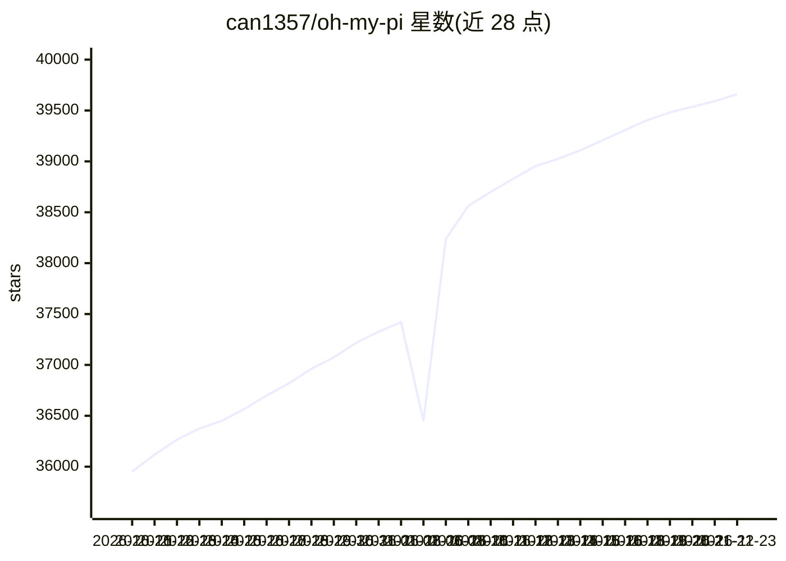

# can1357/oh-my-pi

⭐ 39,660 · TypeScript · MIT · 推送 2026-11-22 · [GitHub](https://github.com/can1357/oh-my-pi) · [官网](https://omp.sh) · 组织维护 · 中文 README

**面向开发者的终端编码 agent，CLI/TUI 内置 IDE 能力**

由 Stencil Labs 维护、基于 Pi 分叉的编码 agent，以 CLI/TUI 运行，支持 60+ 模型提供商、31 个内置工具、14 项 LSP 操作与 28 项 DAP 调试操作，核心以约 8 万行 Rust 实现。内置持久化 Python/Bun 代码执行、LLM 驱动重命名、lldb/dlv/debugpy 调试器会话、流式中断注入规则、subagent 并行、第二模型 advisor 评审、会话共享链接、内容哈希编辑与多格式配置继承。通过 curl 脚本、Homebrew、Bun、Nix、mise 或 PowerShell 安装，支持 macOS/Linux/Windows。

## 筛选速览

| 维度 | 判定 | 备注 |
|---|---|---|
| AI 角色 | `ai-native` | 本体是模型或模型工具 |
| 许可风险 | `permissive` | MIT |
| 部署形态 | `library` | 以包/库形式分发 |
| 模型依赖 | locked-api |  |
| 硬件要求 | — | 无带数字的原话,不猜 |
| 安装摩擦 | `low` | 无编译、无系统依赖或容器化 |
| 成熟度 | — | 结构信号不足 |

## 动量与使用信号

- 维护:`active` — 距上次 push 0.7 天,年发版 100,404 位贡献者
- 涨星:近 1 天 **+138**(自 20261016 起算)
- 下载:GitHub Release 附件 累计 1,574,014(100 个 release)
- 平台:WINDOWS / MACOS / LINUX · 协议:OPENAI-API / MCP / OLLAMA

## 能力要点

- 支持 60+ 模型提供商与 31 个内置工具
- LSP 与 DAP 接入：agent 可执行重命名并驱动 lldb/dlv/debugpy 调试会话
- subagent 并行执行与 advisor 第二模型逐轮评审
- 读取 Cursor MDC、Cline、Codex AGENTS.md、Copilot applyTo 等 8 种现有配置格式

## 适用场景

- 在终端用自然语言驱动编辑、搜索与调试代码
- 在 Zed 编辑器内通过 ACP 驱动同一 agent
- 将改动拆分为原子提交并生成校验过的提交信息
- 与团队成员共享实时 agent 会话进行结对调试

## 场景标签

`编码 Agent` · 领域:编码与开发

## 证据(README 行号)

> L3:  A coding agent with the IDE wired in.
> L21: **60+** providers · **31** built-in tools · **14** lsp ops · **28** dap ops · **~80k** lines of Rust core.

## 星数曲线

2026-10-21 35,953 → 2026-11-23 39,660（+3,707）

---
*卡片 v1 · prompt 1.4 · 生成 2026-11-22 · 置信度 mid · 依据 README sha `f2e7aaec7308` · [字段定义](../../DATASET.md)*
