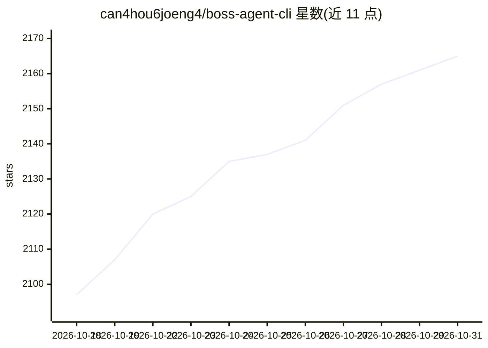

# can4hou6joeng4/boss-agent-cli

⭐ 2,165 · Python · MIT · 推送 2026-10-30 · [GitHub](https://github.com/can4hou6joeng4/boss-agent-cli) · [官网](https://can4hou6joeng4.github.io/boss-agent-cli/) · 个人维护 · 中文 README

**BOSS 直聘终端 CLI：职位搜索、福利筛选与 AI 求职增强**

面向求职者、招聘者与 AI Agent 的 BOSS 直聘命令行工具：关键词搜索加 8 维筛选、福利真实匹配（AND 逻辑、按匹配分排序）、HR 活跃度过滤、本地候选池与统计、可恢复采集（预算/断点/停止控制），以及 JD 分析、简历润色、模拟面试等 AI 求职增强命令（支持 Ollama/vLLM OpenAI 兼容本地模型）。输出统一 JSON 信封，boss schema 为能力真源；可通过 MCP（77 个工具）、subprocess 或 Python API 供 Agent 调用。当前仅支持 zhipin 平台，Python ≥3.10。

## 筛选速览

| 维度 | 判定 | 备注 |
|---|---|---|
| AI 角色 | `ai-enhanced` | 去掉 AI 部分产品仍成立 |
| 许可风险 | `permissive` | MIT |
| 部署形态 | `self-host` | docker 或自建部署 |
| 模型依赖 | local-ok | 支持本地模型 |
| 硬件要求 | — | 无带数字的原话,不猜 |
| 安装摩擦 | `low` | 无编译、无系统依赖或容器化 |
| 成熟度 | — | 结构信号不足 |

## 能力要点

- 福利筛选自动翻页补抓 + AND 真实匹配 + 本地匹配分排序
- MCP 方式暴露 77 个已实现工具，兼容 Claude Desktop / Cursor 等宿主
- AI 求职增强命令支持 Ollama/vLLM 本地模型，模型权重外置不进 Python 包
- 可恢复采集受请求/详情/时长/重试预算约束，可断点恢复与安全点停止

## 适用场景

- 在终端搜索并按福利条件筛选职位，管理本地候选池
- 让 AI Agent 通过 MCP 或 JSON 信封代为执行求职/招聘工作流
- 用本地模型做 JD 分析、简历润色与模拟面试

## 场景标签

`AI 写作` · 领域:内容生成

## 证据(README 行号)

> L24: boss-agent-cli 把职位发现、福利筛选、本地简历与 AI、投递沟通、招聘者候选人处理和可恢复采集统一到一个 CLI。真人直接运行 `boss` 进入纯终端向导；Agent 使用 JSON、schema、MCP 或 Py
> L37: - **AI 求职增强 + 本地模型**：JD 分析、简历润色、定向优化、候选池匹配、模拟面试、沟通指导；本地模型权重外置，支持 Ollama/vLLM OpenAI 兼容接口 —— `ai analyze-jd` `ai loc

## 星数曲线

2026-10-18 2,097 → 2026-10-31 2,165（+68）

---
*卡片 v1 · prompt 1.4 · 生成 2026-10-21 · 置信度 high · 依据 README sha `381129ea2234` · [字段定义](../../DATASET.md)*
