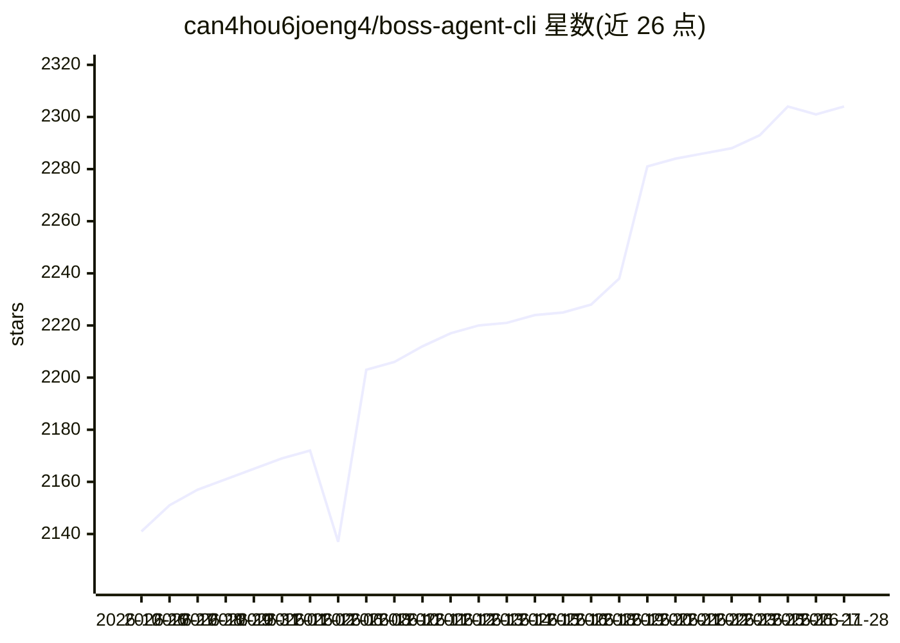

# can4hou6joeng4/boss-agent-cli

⭐ 2,304 · Python · MIT · 推送 2026-11-27 · [GitHub](https://github.com/can4hou6joeng4/boss-agent-cli) · [官网](https://can4hou6joeng4.github.io/boss-agent-cli/) · 个人维护 · 中文 README

**给真人与 AI Agent 用的 BOSS 直聘命令行求职工具**

将 BOSS 直聘的职位搜索、福利筛选、HR 活跃度过滤、候选池管理、批量采集与投递沟通统一为一个 CLI。真人运行 `boss` 进入终端向导；Agent 通过 MCP（暴露 90 个工具）、subprocess 解析 JSON 信封或 Python SDK 调用同一 workflow。stdout 仅输出七键 JSON 信封，`boss schema` 为能力真源；错误携带 code/recoverable/recovery_action 支持程序化恢复。招聘者侧链路当前仅支持 zhipin-recruiter 平台。

## 筛选速览

| 维度 | 判定 | 备注 |
|---|---|---|
| AI 角色 | `ai-enhanced` | 去掉 AI 部分产品仍成立 |
| 许可风险 | `permissive` | MIT |
| 部署形态 | `self-host` | docker 或自建部署 |
| 模型依赖 | local-ok | 支持本地模型 |
| 硬件要求 | — | 无带数字的原话,不猜 |
| 安装摩擦 | `low` | 无编译、无系统依赖或容器化 |
| 成熟度 | — | 结构信号不足 |

## 能力要点

- MCP 方式暴露 90 个已实现工具，支持 Claude Desktop/Cursor 等宿主
- stdout 仅 JSON 信封 + `boss schema` 能力真源，支持 openai-tools/anthropic-tools/mcp-tools 导出
- 福利关键词 AND 逻辑真实匹配与本地匹配分排序，HR 活跃度筛选
- 采集带预算约束、SQLite 断点、可停止，默认不暴露 security_id 等敏感字段

## 适用场景

- 用 AI Agent 按福利条件筛选并跟踪求职候选池
- 招聘者批量处理候选人搜索与简历接收
- 本地整理收藏岗位并做漏斗统计与复盘

## 场景标签

 · 领域:求职招聘/效率工具

## 证据(README 行号)

> L23: boss-agent-cli 把职位发现、福利筛选、本地简历与 AI、投递沟通、招聘者候选人处理和可恢复采集统一到一个 CLI。真人直接运行 `boss` 进入纯终端向导；Agent 使用 JSON、schema、MCP 或 Py
> L36: - **AI 求职增强 + 本地模型**：JD 分析、简历润色、定向优化、候选池匹配、模拟面试、沟通指导；本地模型权重外置，支持 Ollama/vLLM OpenAI 兼容接口 —— `ai analyze-jd` `ai loc
> L70: // 方式一：MCP（推荐）—— Claude Desktop / Cursor 等 MCP 宿主，暴露 90 个已实现工具

## 星数曲线

2026-10-26 2,141 → 2026-11-28 2,304（+163）

---
*卡片 v1 · prompt 1.4 · 生成 2026-11-28 · 置信度 high · 依据 README sha `297ca1081b6b` · [字段定义](../../DATASET.md)*
