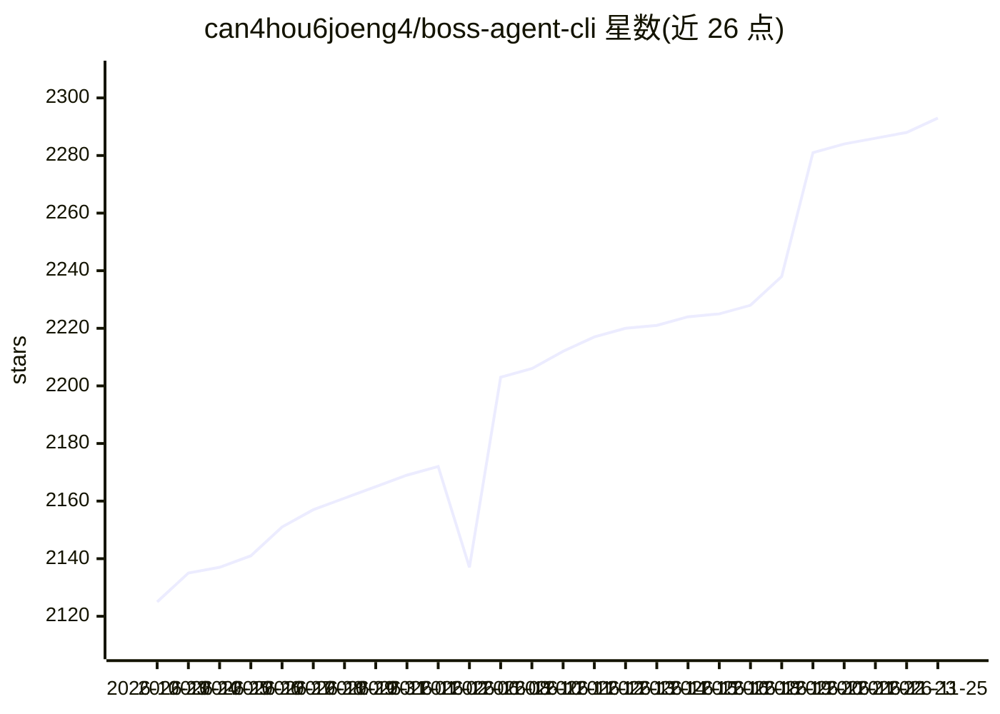

# can4hou6joeng4/boss-agent-cli

⭐ 2,293 · Python · MIT · 推送 2026-11-23 · [GitHub](https://github.com/can4hou6joeng4/boss-agent-cli) · [官网](https://can4hou6joeng4.github.io/boss-agent-cli/) · 个人维护 · 中文 README

**面向真人与 AI Agent 的 BOSS 直聘求职/招聘 CLI**

把 BOSS 直聘的职位搜索、8 维筛选、福利筛选、HR 活跃度过滤、本地候选池管理、可恢复批量采集及招聘者侧候选人处理统一到一个命令行工具。真人通过终端向导使用，Agent 可经 MCP（暴露 80 个工具）、subprocess 解析 JSON 信封或 Python SDK 调用同一套 workflow。输出统一的七键 JSON 信封，`boss schema` 为能力真源。AI 功能包括 JD 分析、简历润色、模拟面试等，本地模型权重外置、支持 OpenAI 兼容接口；浏览器内核仅用于登录与导出，采集受预算与停止条件约束。

## 筛选速览

| 维度 | 判定 | 备注 |
|---|---|---|
| AI 角色 | `ai-enhanced` | 去掉 AI 部分产品仍成立 |
| 许可风险 | `permissive` | MIT |
| 部署形态 | `self-host` | docker 或自建部署 |
| 模型依赖 | local-ok | 支持本地模型 |
| 硬件要求 | — | 无带数字的原话,不猜 |
| 安装摩擦 | `low` | 无编译、无系统依赖或容器化 |
| 成熟度 | — | 结构信号不足 |

## 能力要点

- MCP 方式暴露 80 个已实现工具，支持 Claude Desktop / Cursor 等宿主
- 福利筛选按 AND 逻辑真实匹配并支持本地匹配分排序
- stdout 仅输出七键 JSON 信封，错误带 code/recoverable/recovery_action
- 可恢复批量采集：SQLite 断点、JSON/CSV/XLSX 增量导出、预算与安全点停止

## 适用场景

- 求职者按双休、五险一金等福利条件筛选岗位并管理候选池
- 让 Claude/Cursor 等 Agent 通过 MCP 代为执行搜索、打招呼、复盘
- 招聘者批量处理候选人搜索、简历接收与回复
- 批量采集职位数据并导出为 JSON/CSV/XLSX 做离线分析

## 场景标签

`网页抓取` `AI 写作` · 领域:效率与自动化

## 证据(README 行号)

> L23: boss-agent-cli 把职位发现、福利筛选、本地简历与 AI、投递沟通、招聘者候选人处理和可恢复采集统一到一个 CLI。真人直接运行 `boss` 进入纯终端向导；Agent 使用 JSON、schema、MCP 或 Py
> L36: - **AI 求职增强 + 本地模型**：JD 分析、简历润色、定向优化、候选池匹配、模拟面试、沟通指导；本地模型权重外置，支持 Ollama/vLLM OpenAI 兼容接口 —— `ai analyze-jd` `ai loc

## 星数曲线

2026-10-23 2,125 → 2026-11-25 2,293（+168）

---
*卡片 v1 · prompt 1.4 · 生成 2026-11-23 · 置信度 high · 依据 README sha `8bb1501fb59e` · [字段定义](../../DATASET.md)*
