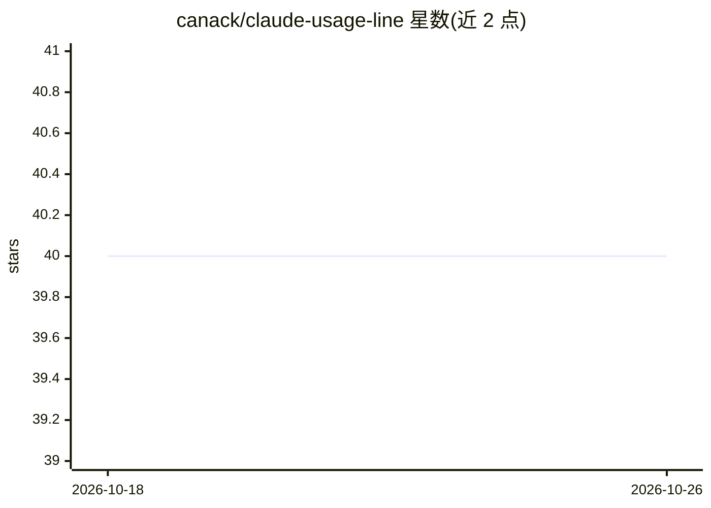

# canack/claude-usage-line

⭐ 40 · TypeScript · MIT · 推送 2026-05-08 · [GitHub](https://github.com/canack/claude-usage-line) · 个人维护

**Claude Code 自定义状态栏：显示限额、git、成本与 diff 统计**

面向 Claude Code 用户的跨平台 statusline 命令行工具：读取 Claude Code 通过 stdin 传入的 JSON，渲染会话上下文占比、5 小时与 7 天滚动限额（Pro/Max）或组织月度配额（Enterprise）、模型名、git 分支、增删行数、成本与时长。零运行时依赖、无需 jq。Enterprise 场景下通过 OAuth 读取已有 Claude Code 登录凭据，后台缓存请求 Anthropic 的 usage 端点（默认 5 分钟 TTL），可用环境变量关闭。通过 npx 安装，Node.js ≥ 18。

## 筛选速览

| 维度 | 判定 | 备注 |
|---|---|---|
| AI 角色 | `ai-ecosystem` | LLM/agent 周边工具 |
| 许可风险 | `permissive` | MIT |
| 部署形态 | `library` | 以包/库形式分发 |
| 模型依赖 | — | README 未给出锁定关系 |
| 硬件要求 | — | 无带数字的原话,不猜 |
| 安装摩擦 | `low` | 无编译、无系统依赖或容器化 |
| 成熟度 | — | 结构信号不足 |

## 能力要点

- Pro/Max 直接消费 stdin 的 rate_limits，无网络调用与 API key
- Enterprise 走 OAuth 后备读取组织月度配额（缓存 5min 默认 TTL）
- 7 种进度条样式与阈值变色（≥50% 黄 / ≥80% 红）
- 支持 --json 输出与 --hide 字段隐藏

## 适用场景

- 在 Claude Code 状态栏实时查看会话上下文与限额消耗
- Enterprise 用户追踪组织月度配额与花费
- 编码时同步看到当前分支、增删行数与成本

## 场景标签

`LLM 可观测性` · 领域:评测与运维

## 证据(README 行号)

> L9: Cross-platform Claude Code statusline — session context, 5-hour & 7-day rate limits (Pro/Max) or **organization mont
> L38: For **Enterprise** users, stdin doesn't include `rate_limits`, so the statusline falls back to a background OAuth c

## 星数曲线

2026-10-18 40 → 2026-10-26 40（+0）

---
*卡片 v1 · prompt 1.4 · 生成 2026-10-25 · 置信度 high · 依据 README sha `5e603fbc75d8` · [字段定义](../../DATASET.md)*
