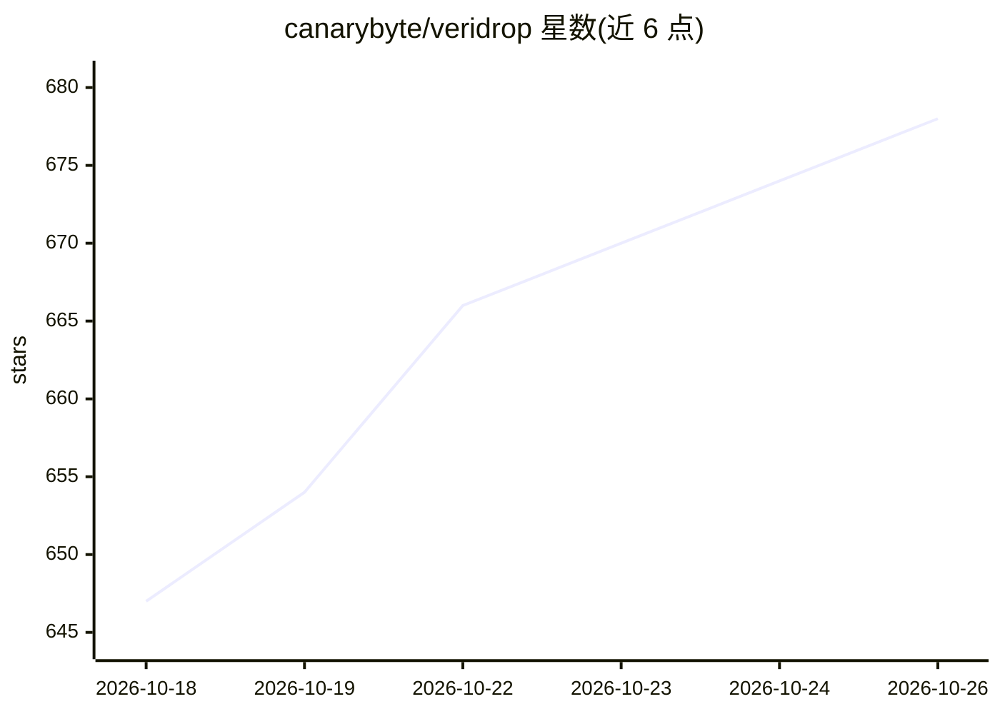

# canarybyte/veridrop

⭐ 678 · Python · AGPL-3.0 · 推送 2026-09-20 · [GitHub](https://github.com/canarybyte/veridrop) · [官网](https://veridrop.app) · 个人维护 · 中文 README

**检测 AI API 中转站真伪与合规性的开源工具，面向开发者和站长**

输入 base_url + api_key + model，对 AI API 中转站发送探针请求，与官方 API 基线做字段级、协议级、加密级对比，输出真伪、能力、合规三类判定。支持 Anthropic Messages、OpenAI Chat Completions、Gemini OpenAI 兼容三种协议，含 thinking 签名校验、usage 后端指纹、三层 needle-in-haystack 长上下文探针等检测器。提供 veridrop.app 托管服务（API key 不落盘）与 CLI + Web 自托管两种方式，附中转站红黑榜排行榜。限制：长上下文加测成本由用户 API key 支付，compare 命令需 full 模式。

## 筛选速览

| 维度 | 判定 | 备注 |
|---|---|---|
| AI 角色 | `ai-ecosystem` | LLM/agent 周边工具 |
| 许可风险 | `viral` | AGPL-3.0 |
| 部署形态 | `library` | 以包/库形式分发 |
| 模型依赖 | — | README 未给出锁定关系 |
| 硬件要求 | — | 无带数字的原话,不猜 |
| 安装摩擦 | `low` | 无编译、无系统依赖或容器化 |
| 成熟度 | — | 结构信号不足 |

## 能力要点

- Claude 协议 thinking_signature 加密签名校验（25% 权重）
- 三层 needle-in-haystack 长上下文探针（32k→100k→200k 及极限档）
- OpenAI 协议 usage 字段后端指纹识别换芯中转站
- Claude 12 项 / OpenAI 8 项 / Gemini 7 项检测器与公开评分权重

## 适用场景

- 买中转站服务前验证是否真的转发到宣称的模型
- 验证中转站是否剥离了 PDF、Tool Use、长上下文等能力
- 核验响应字段、流式协议与 usage 计费是否符合官方规范
- 自托管部署做内部 API 通道质量检测

## 场景标签

`网络安全` · 领域:学习与行业

## 证据(README 行号)

> L6: relay/proxy services.** Given a `base_url + api_key + model`, it runs a suite
> L51: 一个开源的 AI API 中转站(relay / proxy)真伪与质量检测工具。给定一个 `base_url + api_key + model`,自动跑一组探针请求,把结果跟「官方真品基线」做**字段级、协议级、加密级**对比

## 星数曲线

2026-10-18 647 → 2026-10-26 678（+31）

---
*卡片 v1 · prompt 1.4 · 生成 2026-10-21 · 置信度 mid · 依据 README sha `fc7ddc0e110a` · [字段定义](../../DATASET.md)*
