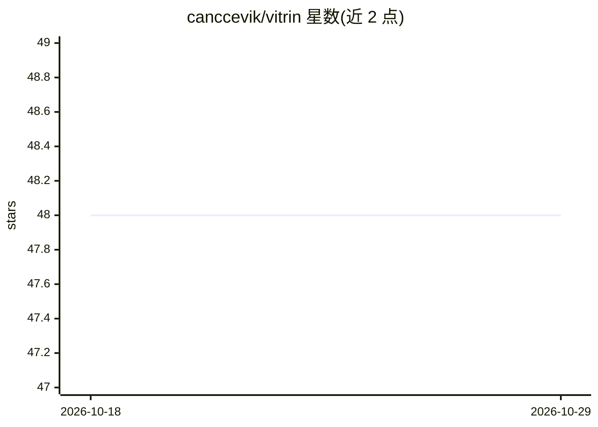

# canccevik/vitrin

⭐ 48 · TypeScript · AGPL-3.0 · 推送 2026-06-13 · [GitHub](https://github.com/canccevik/vitrin) · 个人维护

**社交内容平台微服务后端：含推荐与 ML 排序管线**

以社交内容平台为领域建模的分布式后端架构项目：15 个服务（14 个 NestJS/TypeScript + 1 个 Python 3.12 ML 服务）通过 proto-first gRPC 契约同步调用，RabbitMQ 主题路由承载领域事件，采用 outbox/inbox 模式保证可靠投递。Feed 分为 Redis 支撑的关注时间线（EAGER/LAZY/HYBRID 三种 fanout 策略）与经检索、过滤、LightGBM 打分、重排的首页推荐流；候选来自 Neo4j 图、Qdrant 向量、ClickHouse 趋势与新鲜内容。含 Feast 特征、MLflow 模型注册、模型热替换的持续学习闭环与 saga 工作流编排。面向学习与实践分布式系统与 ML 服务的后端开发者。

## 筛选速览

| 维度 | 判定 | 备注 |
|---|---|---|
| AI 角色 | `ai-enhanced` | 去掉 AI 部分产品仍成立 |
| 许可风险 | `viral` | AGPL-3.0 |
| 部署形态 | `self-host` | docker 或自建部署 |
| 模型依赖 | — | README 未给出锁定关系 |
| 硬件要求 | — | 无带数字的原话,不猜 |
| 安装摩擦 | `low` | 无编译、无系统依赖或容器化 |
| 成熟度 | — | 结构信号不足 |

## 能力要点

- 15 服务拆分：gRPC 契约 + RabbitMQ 事件驱动 + 各服务独立数据边界
- 关注 Feed 的 EAGER/LAZY/HYBRID fanout 投递策略规划
- 首页推荐在线链路：图/向量/趋势检索 + LightGBM 打分 + 重排
- Feast/ClickHouse/LightGBM/MLflow 组成的持续学习闭环与模型热替换
- outbox/inbox 可靠事件、幂等写、Redis 运行时层与 OpenTelemetry 可观测性

## 适用场景

- 学习参考社交平台规模的微服务与事件驱动架构设计
- 搭建带图/向量检索与 ML 排序的 Feed 推荐管线
- 实践在线推理与离线训练闭环的 MLOps 流程
- 了解 outbox/inbox、幂等、saga 补偿等分布式系统模式

## 场景标签

`推荐系统` `MLOps` · 领域:学习与行业

## 证据(README 行号)

> L5: Vitrin is an open-source backend architecture project that uses a social content platform domain to model real distr
> L66: |ML scoring|`ml-service`|Scores from the active LightGBM model|
> L99: `ml-service` is a dedicated Python 3.12 runtime. Recommendation Service builds the candidate pool and sends hydrate

## 星数曲线

2026-10-18 48 → 2026-10-29 48（+0）

---
*卡片 v1 · prompt 1.4 · 生成 2026-10-25 · 置信度 low · 依据 README sha `0bb36ef9bbb6` · [字段定义](../../DATASET.md)*
