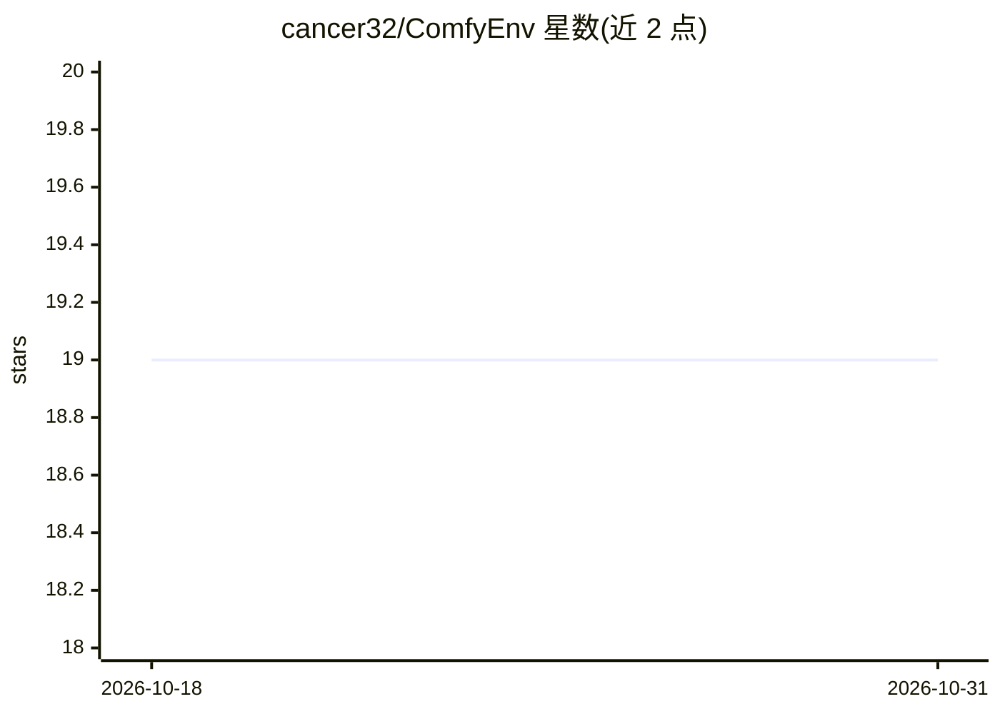

# cancer32/ComfyEnv

⭐ 19 · Python · Apache-2.0 · 推送 2026-06-28 · [GitHub](https://github.com/cancer32/ComfyEnv) · 个人维护

**ComfyUI 的隔离环境管理器：避免自定义节点依赖冲突**

为 ComfyUI 提供 Conda 隔离环境管理的工具：每个项目或节点集合可运行在独立沙箱中，避免依赖冲突破坏现有安装。功能包括按指定 Python 版本与 ComfyUI 版本创建环境、运行 ComfyUI、节点配置隔离，提供 CLI 与 GUI 两种界面。支持 Windows 与 Linux（macOS 不支持），要求预装 Miniconda3、Git 和 NVIDIA GPU（不支持 AMD/Intel GPU），从源码克隆安装。

## 筛选速览

| 维度 | 判定 | 备注 |
|---|---|---|
| AI 角色 | `ai-ecosystem` | LLM/agent 周边工具 |
| 许可风险 | `permissive` | Apache-2.0 |
| 部署形态 | `library` | 以包/库形式分发 |
| 模型依赖 | — | README 未给出锁定关系 |
| 硬件要求 | — | 无带数字的原话,不猜 |
| 安装摩擦 | `low` | 无编译、无系统依赖或容器化 |
| 成熟度 | — | 结构信号不足 |

## 能力要点

- 每个 ComfyUI 设置独立的 Conda 隔离环境
- 按 Python 版本与 ComfyUI 版本创建环境（如 --python=3.13 --comfyui-version=v0.26.2）
- CLI 与 GUI 双界面管理环境
- status 命令查看环境运行状态

## 适用场景

- 多个 ComfyUI 项目各用不同依赖版本互不干扰
- 安装依赖冲突的自定义节点前建立隔离沙箱
- 通过 GUI 在 Windows/Linux 上管理 ComfyUI 环境

## 场景标签

 · 领域:AI 工作流工具链管理

## 证据(README 行号)

> L5: ComfyUI is incredibly flexible, but installing different custom nodes or dependencies often leads to conflicts that 
> L15: - Isolated **Conda environments** per ComfyUI setup

## 星数曲线

2026-10-18 19 → 2026-10-31 19（+0）

---
*卡片 v1 · prompt 1.4 · 生成 2026-10-28 · 置信度 mid · 依据 README sha `913c19299ee3` · [字段定义](../../DATASET.md)*
