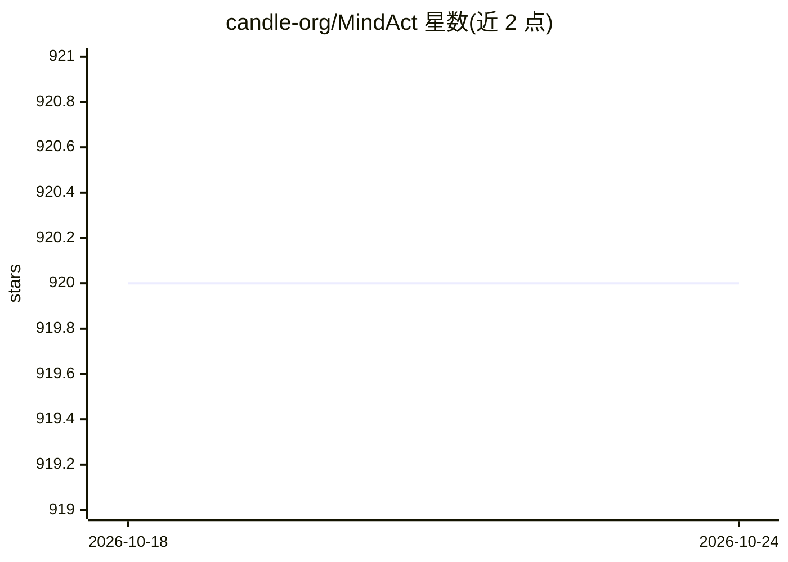

# candle-org/MindAct

⭐ 920 · Python · Apache-2.0 · 推送 2026-09-01 · [GitHub](https://github.com/candle-org/MindAct) · [官网](http://mindnlp.readthedocs.io/) · 组织维护

**桌面操作任务模仿学习策略的可复现训练评测框架**

面向具身智能研究的训练与评测工具包：通过协议化适配器接口集成 LeRobot 数据集与策略、LIBERO 仿真基准，用 YAML 配置与 manifest 记录实验溯源，提供标准化评测协议与产物目录管理。torch/lerobot/libero 均为可选依赖并懒加载；提供无真实依赖的 fake runner 冒烟评测路径。v0.1 为初始骨架版本，当前阶段聚焦统一可复现训练评测。仓库由 MindNLP（MindSpore NLP 库）完全转型而来，旧代码保留在 legacy 分支。

## 筛选速览

| 维度 | 判定 | 备注 |
|---|---|---|
| AI 角色 | `ai-ecosystem` | LLM/agent 周边工具 |
| 许可风险 | `permissive` | Apache-2.0 |
| 部署形态 | `library` | 以包/库形式分发 |
| 模型依赖 | — | README 未给出锁定关系 |
| 硬件要求 | — | 无带数字的原话,不猜 |
| 安装摩擦 | `low` | 无编译、无系统依赖或容器化 |
| 成熟度 | `idea` | |

## 能力要点

- 数据集/策略/环境的协议化适配器接口
- YAML 配置 + manifest 实验溯源
- torch/lerobot/libero 可选依赖懒加载（extras）
- fake runner 无依赖评测冒烟路径

## 适用场景

- 在 LIBERO 基准上复现模仿学习实验
- 管理具身策略训练的检查点、日志与配置溯源
- 不装重依赖先验证评测流程是否走通

## 场景标签

`模型评测` · 领域:评测与运维

## 证据(README 行号)

> L3: **A PyTorch and Hugging Face native training and evaluation toolkit for embodied policies**
> L5: MindAct is a reproducible training and evaluation framework for imitation learning policies on desktop manipulation 

## 星数曲线

2026-10-18 920 → 2026-10-24 920（+0）

---
*卡片 v1 · prompt 1.4 · 生成 2026-10-21 · 置信度 mid · 依据 README sha `a9c484e7de4f` · [字段定义](../../DATASET.md)*
