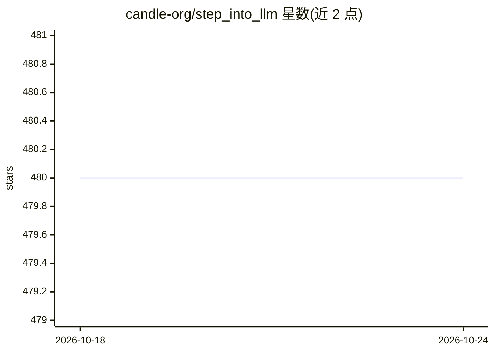

# candle-org/step_into_llm

⭐ 480 · Jupyter Notebook · Apache-2.0 · 推送 2025-12-22 · [GitHub](https://github.com/candle-org/step_into_llm) · 组织维护 · 中文 README

**昇思MindSpore大模型技术公开课：课件与代码开源的课程仓库**

由昇思MindSpore社区维护的大模型技术公开课配套仓库：课程覆盖Transformer、BERT、GPT、ChatGLM、LLaMA、RLHF、MoE、量化等28讲主题，随授课逐步上传PPT与代码，视频回放归档至b站，报名后免费参与。课前学习要求Python、深度学习基础及MindSpore/MindFormers使用，可在OpenI启智社区免费获取算力。课程内容基于昇思MindSpore框架与MindNLP等生态工具进行讲解与演示。

## 筛选速览

| 维度 | 判定 | 备注 |
|---|---|---|
| AI 角色 | `ai-knowledge` | 知识聚合/清单类 |
| 许可风险 | `permissive` | Apache-2.0 |
| 部署形态 | `None` |  |
| 模型依赖 | — | README 未给出锁定关系 |
| 硬件要求 | — | 无带数字的原话,不猜 |
| 安装摩擦 | `low` | 无编译、无系统依赖或容器化 |
| 成熟度 | — | 结构信号不足 |

## 能力要点

- 28讲大模型主题课程，课件与代码逐步开源
- 从Transformer到ChatGLM/LLaMA/RLHF/MoE/量化的演进讲解
- 配套MindSpore分布式并行、MindFormers等生态工具教学
- OpenI启智社区可免费获取算力

## 适用场景

- 系统学习大模型从原理到部署的全流程技术
- 跟随课程基于MindSpore实践模型微调与推理
- 获取各讲PPT、代码与知识点总结资料

## 场景标签

`教程课程` · 领域:学习与行业

## 证据(README 行号)

> L1: # 昇思MindSpore技术公开课
> L48: |章节序号|章节名称|课程简介|视频|课件及代码|知识点总结|
> L50: |第一讲|Transformer|Multi-head self-attention原理。Masked self-attention的掩码处理方式。基于Transformer的机器翻译任务训练。|link|link|link|

## 星数曲线

2026-10-18 480 → 2026-10-24 480（+0）

---
*卡片 v1 · prompt 1.4 · 生成 2026-10-22 · 置信度 high · 依据 README sha `77e8c897c201` · [字段定义](../../DATASET.md)*
