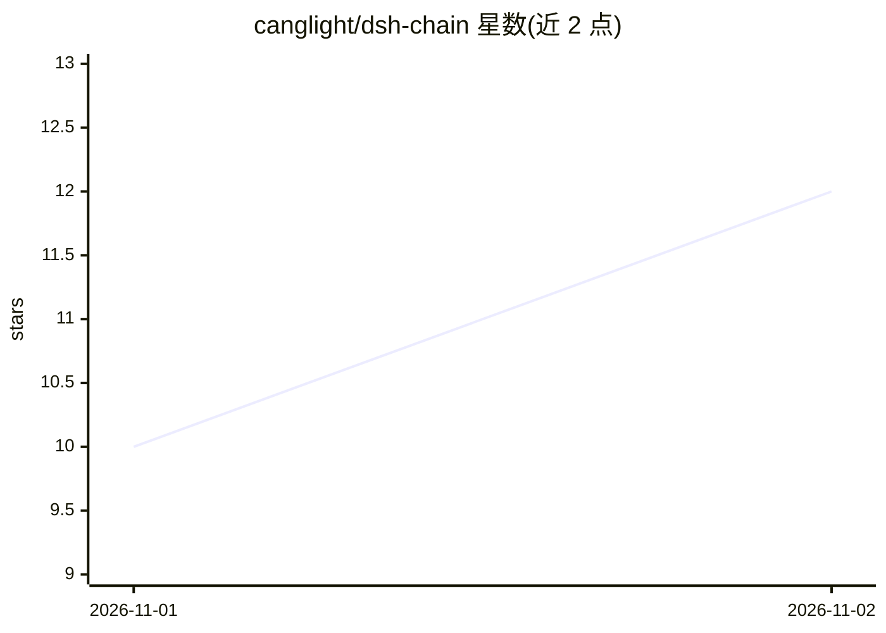

# canglight/dsh-chain

⭐ 12 · JavaScript · MIT · 推送 2026-11-01 · [GitHub](https://github.com/canglight/dsh-chain) · 个人维护 · 中文 README

**DSH 记忆插件：记录决策理由并每轮注入提示**

面向 DeepSeek Harness（DSH）的思维链记忆插件：将每条判断（判断+依据+犹豫+结论+标签）存为本地 JSONL，每轮从磁盘重新渲染注入系统提示，上下文压缩后仍保留。记忆按 8 个池分层，各有半衰期与归档期限，被检索命中的次数可延长半衰期；检索采用 IDF 罕见词与字符二元组两路 RRF 融合，可选安装 transformers 语义检索。提供 8 个工具（写入/检索/图谱导出/确认/元记忆问答等）、每日夜巡报告与 3D 星云可视化。全本地存储、不联网；仅 Windows + DSH 0.2.0-rc 验证过。

## 筛选速览

| 维度 | 判定 | 备注 |
|---|---|---|
| AI 角色 | `ai-ecosystem` | LLM/agent 周边工具 |
| 许可风险 | `permissive` | MIT |
| 部署形态 | `library` | 以包/库形式分发 |
| 模型依赖 | — | README 未给出锁定关系 |
| 硬件要求 | — | 无带数字的原话,不猜 |
| 安装摩擦 | `low` | 无编译、无系统依赖或容器化 |
| 成熟度 | — | 结构信号不足 |

## 能力要点

- 判断以 JSONL 存储并每轮注入系统提示，上下文压缩不影响
- 8 池分级遗忘，按命中次数延长半衰期
- IDF + 字符二元组两路 RRF 融合检索，可选语义检索
- 夜巡自动整理报告与 3D 星云可视化 tab

## 适用场景

- 让 DSH 记住决策背后的理由而非仅结论
- 跨会话共享同一条记忆链
- 审查记忆的置信度、矛盾与生命周期状态

## 场景标签

`Agent 记忆` · 领域:Agent 开发

## 证据(README 行号)

> L7: > 给 DeepSeek Harness 用的记忆插件。
> L32: |上下文一压缩，为什么这么定的理由就丢了|判断存成 JSONL，**每轮从磁盘重新渲染进系统提示**，跟对话历史无关，压不掉|

## 星数曲线

2026-11-01 10 → 2026-11-02 12（+2）

---
*卡片 v1 · prompt 1.4 · 生成 2026-11-02 · 置信度 mid · 依据 README sha `40ef0297d970` · [字段定义](../../DATASET.md)*
