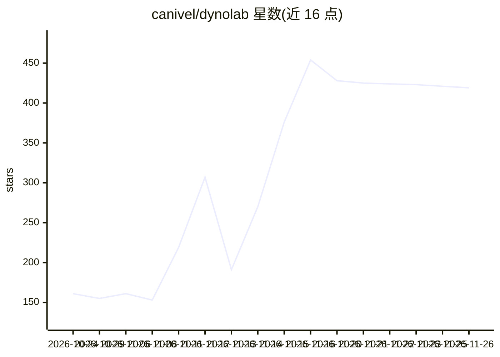

# canivel/dynolab

⭐ 419 · Python · MIT · 推送 2026-11-25 · [GitHub](https://github.com/canivel/dynolab) · [官网](https://dynolab.dev) · 个人维护

**Apple Silicon 上的 AI 安全与可解释性研究工作台**

面向 AI 安全、对齐与可解释性研究的免费开源 Mac 应用：本地运行 MLX/GGUF 模型，提供激活捕获、线性探针训练、TopK SAE 实验、因果 patch 扫描、干预（缩放/消融/引导）等研究工具，实验结果存入本地 Studies 笔记本。配套 Python SDK、HTTP API、本地 MCP bridge 与 OpenAI 兼容 Router；可让 Claude Code/Codex 在本地模型上运行。要求 Apple Silicon 与 macOS 14+，评估基于 Inspect AI。

## 筛选速览

| 维度 | 判定 | 备注 |
|---|---|---|
| AI 角色 | `ai-ecosystem` | LLM/agent 周边工具 |
| 许可风险 | `permissive` | MIT |
| 部署形态 | `None` |  |
| 模型依赖 | local-ok | 支持本地模型 |
| 硬件要求 | — | 无带数字的原话,不猜 |
| 安装摩擦 | `low` | 无编译、无系统依赖或容器化 |
| 成熟度 | — | 结构信号不足 |

## 能力要点

- 激活捕获、探针训练、SAE 实验、干预/引导等本地可解释性研究工具
- Assistant 以本地模型规划并生成测试配置，运行前需用户批准
- Python SDK、HTTP API 与本地 MCP 三种脚本化接口
- 实验性 GPU 池可跨 Mac 与 Windows NVIDIA 机器跑大 GGUF 模型

## 适用场景

- 在本地复现谄媚、越权等安全行为的 Agent 沙盒测试
- 训练线性探针并检查留存集指标与对照基线
- 用因果 patch 扫描定位特定行为对应的层与特征
- 通过 SDK/API 把可解释性实验纳入自动化研究流程

## 场景标签

`科研工具` · 领域:学习与行业

## 证据(README 行号)

> L21: **Dyno Lab is a free, open-source Mac app for running AI models and investigating how they behave.** Ask a question
> L129: Use the **Python SDK**, **HTTP APIs** or **local MCP bridge** to script studies and connect your tools. Start with

## 星数曲线

2026-10-24 161 → 2026-11-26 419（+258）

---
*卡片 v1 · prompt 1.4 · 生成 2026-11-25 · 置信度 high · 依据 README sha `0a260765919f` · [字段定义](../../DATASET.md)*
