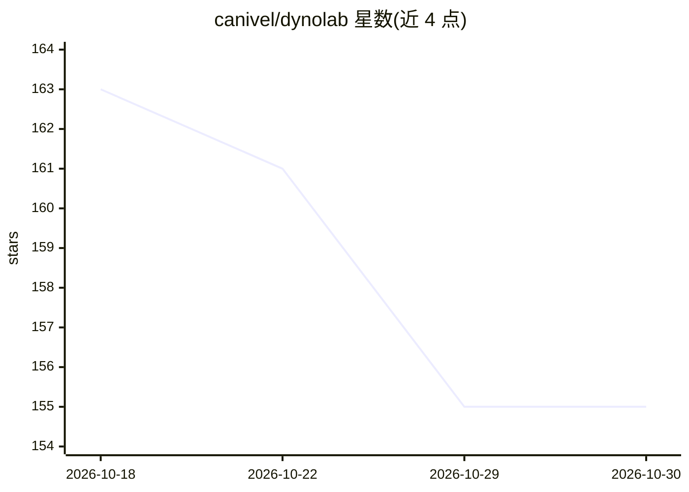

# canivel/dynolab

⭐ 155 · Python · MIT · 推送 2026-10-29 · [GitHub](https://github.com/canivel/dynolab) · [官网](https://dynolab.dev) · 个人维护

**面向 Apple Silicon 的本地 AI 安全与可解释性研究工作台**

开源 macOS 应用（MIT），用于在本地运行 MLX/GGUF 模型并研究其行为：在可视化工作区中提问、查看请求、捕获内部激活，进行干预（缩放/消融/patch/steering）、训练线性探针与小型稀疏自编码器，并以本地笔记本保存与对比实验。内建助手按自然语言描述生成测试配置，另有 Python SDK、HTTP API 与本地 MCP 桥接以脚本化研究。提供 OpenAI 兼容 Router 与可选的 Mac+Windows NVIDIA GPU 池化推理。需 Apple Silicon 与 macOS 14+；研究工具自述为实验性质，不含完整 circuit tracing。

## 筛选速览

| 维度 | 判定 | 备注 |
|---|---|---|
| AI 角色 | `ai-ecosystem` | LLM/agent 周边工具 |
| 许可风险 | `permissive` | MIT |
| 部署形态 | `None` |  |
| 模型依赖 | local-ok | 支持本地模型 |
| 硬件要求 | — | 无带数字的原话,不猜 |
| 安装摩擦 | `low` | 无编译、无系统依赖或容器化 |
| 成熟度 | `idea` | |

## 能力要点

- 激活捕获、干预、线性探针与 SAE 训练等可解释性研究工具
- 本地运行 MLX 模型，GGUF 池化推理可跨 Mac 与 Windows NVIDIA worker
- Python SDK / HTTP API / 本地 MCP 桥接脚本化研究流程
- OpenAI 兼容 Router 端点，支持局域网内共享推理

## 适用场景

- 在本地捕获模型激活并训练探针验证假设
- 对模型行为做干预实验并保存可复现的研究记录
- 用一条命令在自有模型上运行 Claude Code 或 Codex
- 跨 Mac 与 NVIDIA GPU 池化运行较大 GGUF 模型

## 场景标签

`科研工具` `推理引擎` · 领域:学习与行业

## 证据(README 行号)

> L21: **Dyno Lab is a free, open-source Mac app for running AI models and investigating how they behave.** Ask a question
> L114: |**Router**|One OpenAI-compatible endpoint for your tools; optional LAN inference sharing.|
> L129: Use the **Python SDK**, **HTTP APIs** or **local MCP bridge** to script studies and connect your tools. Start with

## 星数曲线

2026-10-18 163 → 2026-10-30 155（-8）

---
*卡片 v1 · prompt 1.4 · 生成 2026-10-22 · 置信度 high · 依据 README sha `ba531825c94a` · [字段定义](../../DATASET.md)*
