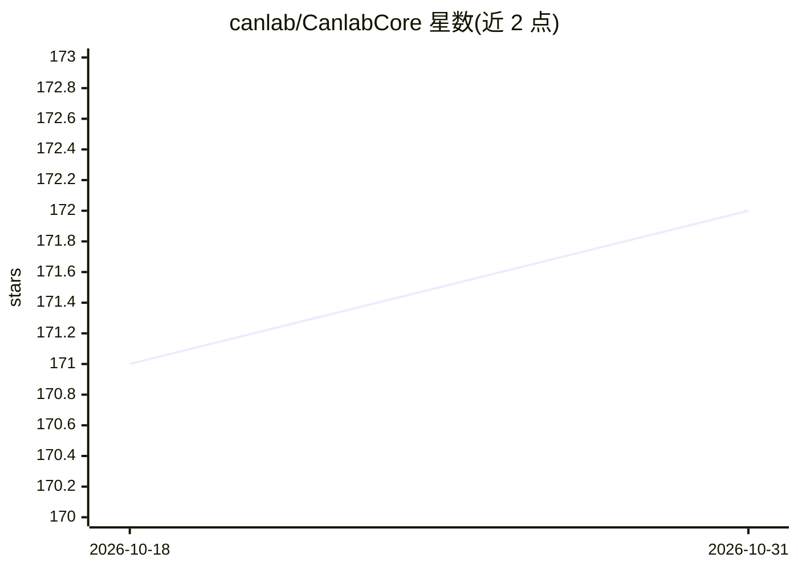

# canlab/CanlabCore

⭐ 172 · MATLAB · NOASSERTION · 推送 2026-10-26 · [GitHub](https://github.com/canlab/CanlabCore) · [官网](https://canlab.github.io/CanlabCore/) · 组织维护

**MATLAB 神经影像（fMRI/PET）分析核心工具箱**

Canlab 认知与情感神经科学实验室（Tor Wager 组）维护的 MATLAB 工具箱，提供面向对象的 MRI/fMRI/PET 分析工具：fmri_data 等对象类型配合 plot/predict/ica 等高层命令完成分析，其中 predict 做基于脑数据的交叉验证多变量预测。内含 fMRI 设计优化、HRF 估计、变点分析、诊断等子工具箱，是其他 Canlab 工具箱（多层中介等）的运行依赖。依赖 MATLAB 及其统计、信号处理工具箱和 SPM 软件，文档含对象方法参考、可视化和端到端工作流指南。

## 筛选速览

| 维度 | 判定 | 备注 |
|---|---|---|
| AI 角色 | `ai-enhanced` | 去掉 AI 部分产品仍成立 |
| 许可风险 | `none` | NOASSERTION |
| 部署形态 | `None` |  |
| 模型依赖 | — | README 未给出锁定关系 |
| 硬件要求 | — | 无带数字的原话,不猜 |
| 安装摩擦 | `low` | 无编译、无系统依赖或容器化 |
| 成熟度 | — | 结构信号不足 |

## 能力要点

- 面向对象设计：fmri_data 等对象配合高层命令（plot/predict/ica）完成分析
- 交叉验证多变量预测基于脑数据（SVM 等机器学习教程）
- 捆绑 OptimizeGA 设计优化、HRF 估计、HEWMA 变点分析、诊断等子工具箱
- 其他 Canlab 工具箱（多层中介、血流动力学估计）的运行依赖

## 适用场景

- 我在 MATLAB 中做 fMRI/PET 数据的预处理与统计分析
- 我需要用多变量机器学习方法从脑数据预测结果变量
- 我使用 Canlab 中介分析等其他工具箱，需要安装此核心依赖

## 场景标签

 · 领域:神经影像分析/神经科学

## 证据(README 行号)

> L6: This repository contains core tools for MRI/fMRI/PET analysis from the Cognitive and Affective Neuorscience Lab (Tor
> L8: The tools include object-oriented tools for doing neuroimaging analysis with simple commands and scripts that provid

## 星数曲线

2026-10-18 171 → 2026-10-31 172（+1）

---
*卡片 v1 · prompt 1.4 · 生成 2026-10-22 · 置信度 mid · 依据 README sha `ebbe8383a19c` · [字段定义](../../DATASET.md)*
