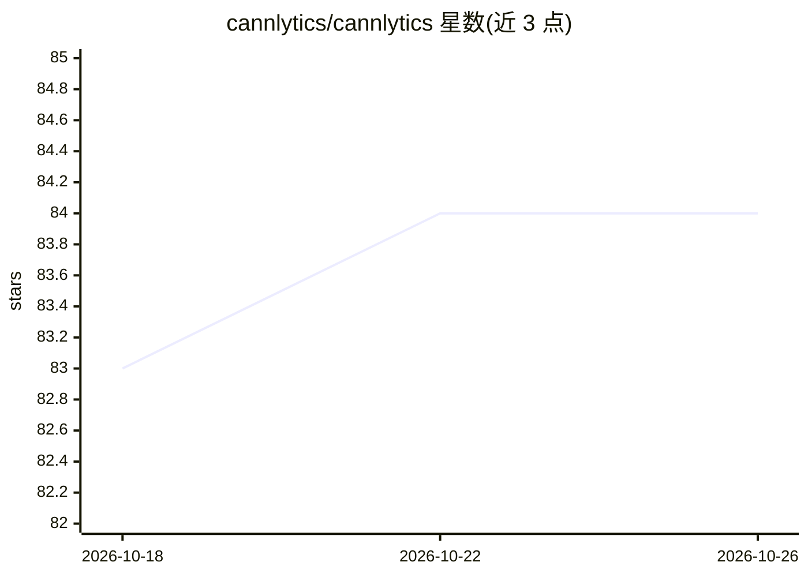

# cannlytics/cannlytics

⭐ 84 · Python · MIT · 推送 2026-10-20 · [GitHub](https://github.com/cannlytics/cannlytics) · [官网](https://cannlytics.com) · 组织维护

**大麻行业数据分析 Python 库：COA 解析、实验室结果与 Metrc 合规数据**

面向大麻产业数据工作流的 Python 包：解析 COA（分析证书）PDF 提取实验室结果（先跑实验室专属算法，再走 Anthropic→OpenAI→Gemini→xAI 多供应商回退的 AI 路径）、加载已发布的 99.5 万+条实验室结果与 4.1 万+条许可数据（Parquet）、封装 Metrc v1 种子到销售追踪 API 与 Firebase（Firestore/Auth/Storage）。核心为数据清洗、标准化与哈希校验；AI 能力（COA 解析、文本/图像/PDF 嵌入与向量搜索）为可选 extra。要求 Python 3.11+，各 API key 均可选并从环境变量读取。限制：Metrc 客户端仅支持 v1，官方说明 v1 正逐州退役。

## 筛选速览

| 维度 | 判定 | 备注 |
|---|---|---|
| AI 角色 | `ai-enhanced` | 去掉 AI 部分产品仍成立 |
| 许可风险 | `permissive` | MIT |
| 部署形态 | `library` | 以包/库形式分发 |
| 模型依赖 | — | README 未给出锁定关系 |
| 硬件要求 | — | 无带数字的原话,不猜 |
| 安装摩擦 | `low` | 无编译、无系统依赖或容器化 |
| 成熟度 | `idea` | |

## 能力要点

- COA PDF 混合解析引擎：实验室专属算法优先，AI 多供应商回退链
- 发布数据资产：99.5 万+实验室结果、4.1 万+许可、5000+菌株记录
- Metrc v1 API 客户端与 Firebase 封装（含 Firestore Enterprise 多数据库）
- 全文 SHA-256 哈希体系与文本/图像/PDF 嵌入向量搜索

## 适用场景

- 从 COA PDF 批量提取并标准化实验室检测结果
- 按州、年份、分析物加载大麻实验室结果数据集做分析
- 通过 Metrc API 对接种子到销售合规数据
- 对 COA 文档做嵌入、相似检索与离群检测

## 场景标签

`数据分析` `文档解析` · 领域:效率与自动化

## 证据(README 行号)

> L3: **Simple Cannabis Analytics** — The `cannlytics` Python package provides tools to wrangle, augment, archive, and ana
> L126: |`cannlytics.data.coas`|COA parsing engine — AI-powered with multi-provider fallback|`pip install cannlytics[coa,a
> L140: |`cannlytics.ai`|Text, image, and PDF embeddings (OpenAI, Gemini); vector search, PCA, outliers|Core to import; `p

## 星数曲线

2026-10-18 83 → 2026-10-26 84（+1）

---
*卡片 v1 · prompt 1.4 · 生成 2026-10-24 · 置信度 mid · 依据 README sha `d82b9f06bc84` · [字段定义](../../DATASET.md)*
