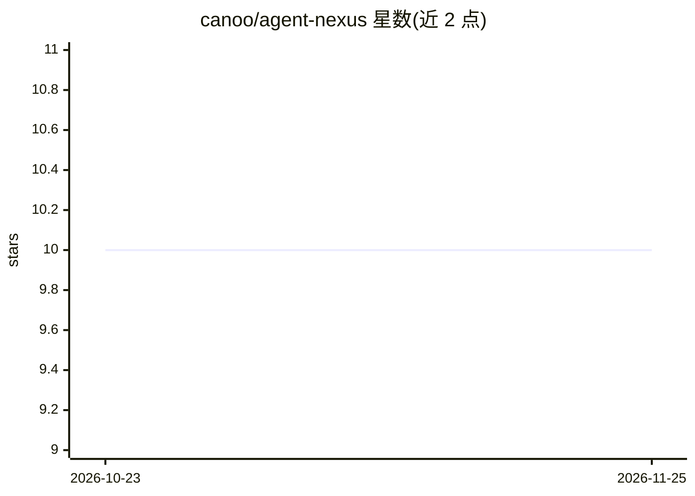

# canoo/agent-nexus

⭐ 10 · Go · MIT · 推送 2026-11-22 · [GitHub](https://github.com/canoo/agent-nexus) · [官网](https://nexus.codelogiic.com/) · 组织维护

**多模型 Agent 编排框架：统一配置、按复杂度路由本地或云端 LLM**

Go 编写的终端编排层：将项目指令、专家 persona 与路由规则一次性维护，并投影到 Claude Code、Gemini CLI、Kiro 等已集成工具的原生配置格式。按任务复杂度将 commit 信息、lint 修复等微任务路由到本地 Ollama 模型，云回退需显式启用 --allow-cloud-fallback。提供 nexus-ollama MCP 服务器、交互式 TUI（安装、健康检查、SQLite 任务日志、项目记忆）与本地保留/删除控制。已集成工具经 Linux/macOS 测试覆盖，更多工具投影列为计划。

## 筛选速览

| 维度 | 判定 | 备注 |
|---|---|---|
| AI 角色 | `ai-ecosystem` | LLM/agent 周边工具 |
| 许可风险 | `permissive` | MIT |
| 部署形态 | `None` |  |
| 模型依赖 | local-ok | 支持本地模型 |
| 硬件要求 | `gpu-8g` | |
| 安装摩擦 | `low` | 无编译、无系统依赖或容器化 |
| 成熟度 | `idea` | |

## 能力要点

- 按复杂度路由到本地 Ollama 模型，云回退需显式批准
- 统一配置投影：一份指令文件生成各工具原生格式
- nexus-ollama MCP 服务器暴露 6 个本地委托工具
- TUI 覆盖安装、健康检查、任务日志与项目记忆

## 适用场景

- 让 commit 信息、boilerplate 等微任务走本地模型省云端 token
- 多套 AI 编码工具间共享同一份项目指令与 persona
- 通过 MCP 让任意客户端把任务委托到本地 Ollama

## 场景标签

`模型网关` · 领域:Agent 开发

## 证据(README 行号)

> L49: **NEXUS is the layer underneath all of them.** Define your project instructions, personas, and routing rules once. 
> L55: NEXUS routes suitable micro-tasks to local Ollama models based on complexity,
> L86: The `nexus-ollama` MCP server exposes local Ollama delegation as standard MCP tools. Any MCP-capable client can rou

## 星数曲线

2026-10-23 10 → 2026-11-25 10（+0）

---
*卡片 v1 · prompt 1.4 · 生成 2026-11-20 · 置信度 high · 依据 README sha `b776ed20347c` · [字段定义](../../DATASET.md)*
