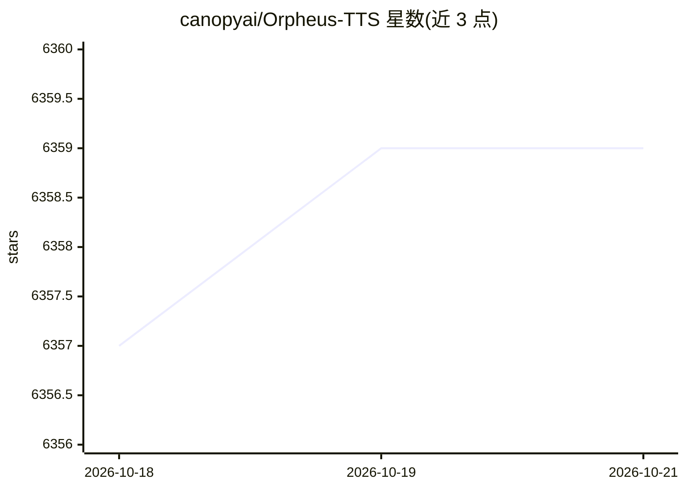

# canopyai/Orpheus-TTS

⭐ 6,359 · Python · Apache-2.0 · 推送 2025-12-05 · [GitHub](https://github.com/canopyai/Orpheus-TTS) · [官网](https://canopylabs.ai) · 组织维护

**基于 Llama-3b 的开源文语合成（TTS）模型**

Orpheus TTS 是构建在 Llama-3b 骨干上的开源文本转语音系统，提供 2 个英文模型（微调生产版与 100k+ 小时英文语音预训练版）及 7 对多语言研究预览模型。支持零样本语音克隆、情感标签控制（laugh/sigh 等 8 种）、约 200ms 流式延迟（输入流式可降至约 100ms）。推理通过 orpheus-speech Python 包（底层使用 vllm）进行，提供 Colab 笔记本与 Baseten 一键部署；附数据处理脚本、微调与预训练训练流程，无 GPU 可用 llama.cpp 推理。

## 筛选速览

| 维度 | 判定 | 备注 |
|---|---|---|
| AI 角色 | `ai-native` | 本体是模型或模型工具 |
| 许可风险 | `permissive` | Apache-2.0 |
| 部署形态 | `library` | 以包/库形式分发 |
| 模型依赖 | local-ok | 支持本地模型 |
| 硬件要求 | — | 无带数字的原话,不猜 |
| 安装摩擦 | `medium` | 含编译或系统依赖之一 |
| 成熟度 | `idea` | |

## 能力要点

- 零样本语音克隆，无需预先微调
- 情感与语调标签控制（<laugh>/<sigh> 等 8 种）
- 约 200ms 流式延迟，输入流式可降至约 100ms
- 提供微调/预训练训练脚本与数据格式说明

## 适用场景

- 为应用生成拟人语音（TTS API 集成）
- 零样本克隆目标音色做语音合成
- 用自己的文本-语音数据微调专属语音模型

## 场景标签

`语音合成` · 领域:内容生成

## 证据(README 行号)

> L9: Orpheus TTS is a SOTA open-source text-to-speech system built on the Llama-3b backbone. Orpheus demonstrates the eme
> L20: - **Low Latency**: ~200ms streaming latency for realtime applications, reducible to ~100ms with input streaming

## 星数曲线

2026-10-18 6,357 → 2026-10-21 6,359（+2）

---
*卡片 v1 · prompt 1.4 · 生成 2026-10-20 · 置信度 high · 依据 README sha `63aeb06e7d69` · [字段定义](../../DATASET.md)*
