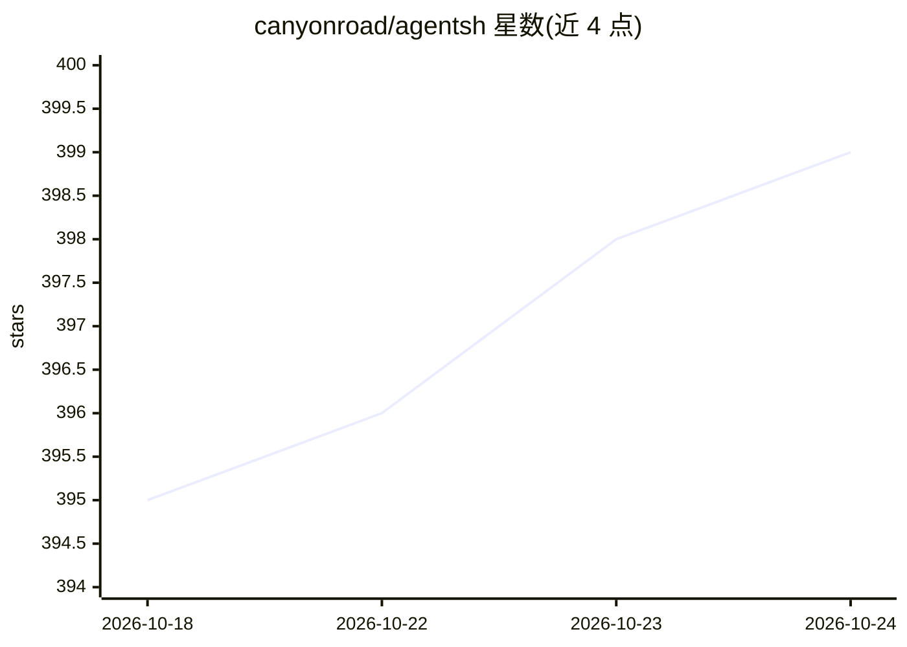

# canyonroad/agentsh

⭐ 400 · Go · Apache-2.0 · 推送 2026-09-15 · [GitHub](https://github.com/canyonroad/agentsh) · [官网](https://www.agentsh.org) · 个人维护

**面向 AI agent 的策略强制执行 shell 网关与审计层**

agentsh 是运行在 agent/工具之下的执行层安全网关：拦截文件、网络、进程、信号及子进程树的操作，按策略做出 allow/deny/approve/redirect/audit/soft_delete 决策，并输出结构化审计事件。提供内嵌 PostgreSQL 代理做 SQL 语句级策略、HTTP 服务出站路由、MCP 安全（工具白名单、rug pull 检测、限流）、环境变量策略与人工审批（TOTP/WebAuthn/API）。Linux 全量强制，macOS ESF+NE 处于 Alpha，Windows 推荐 WSL2。安装提供 Homebrew cask、.deb/.rpm/.apk 包、源码编译与 Docker 镜像示例。

## 筛选速览

| 维度 | 判定 | 备注 |
|---|---|---|
| AI 角色 | `ai-ecosystem` | LLM/agent 周边工具 |
| 许可风险 | `permissive` | Apache-2.0 |
| 部署形态 | `desktop` | 安装包/桌面程序 |
| 模型依赖 | — | README 未给出锁定关系 |
| 硬件要求 | — | 无带数字的原话,不猜 |
| 安装摩擦 | `low` | 无编译、无系统依赖或容器化 |
| 成熟度 | `idea` | |

## 能力要点

- 对文件/网络/进程/信号及子进程树的逐操作策略决策与审计事件
- redirect 决策：拦截后替换命令并把写入重定向回工作区
- 内嵌 PostgreSQL 代理做 SQL 语句分类与策略，HTTP 服务出站管控
- MCP 安全：工具白名单、版本固定检测、跨服务器数据外传检测

## 适用场景

- 让 agent 的每条命令及子进程在策略与审计之下执行
- 对 agent 的数据库与 HTTP API 调用做语句级/路径级管控
- 需要人工审批（TOTP/WebAuthn）的高风险操作场景

## 场景标签

`网络安全` · 领域:学习与行业

## 证据(README 行号)

> L9: agentsh sits *under* your agent/tooling—intercepting **file**, **network**, **process**, and **signal** activity (in
> L15: - **Drop-in shell/exec endpoint** that turns every command (and its subprocesses) into auditable events.

## 星数曲线

2026-10-18 395 → 2026-10-24 399（+4）

---
*卡片 v1 · prompt 1.4 · 生成 2026-10-21 · 置信度 mid · 依据 README sha `12cb5adffc37` · [字段定义](../../DATASET.md)*
