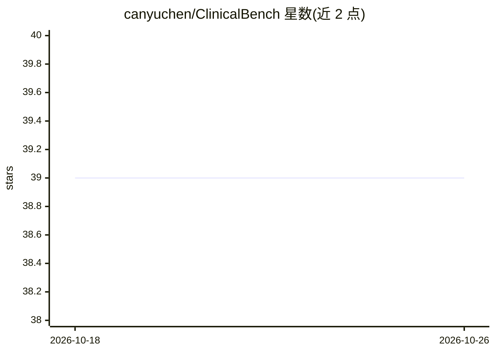

# canyuchen/ClinicalBench

⭐ 39 · Python · MIT · 推送 2026-09-29 · [GitHub](https://github.com/canyuchen/ClinicalBench) · [官网](https://clinicalbench.github.io) · 组织维护

**临床预测基准：22 个 LLM 对 11 个传统 ML 模型的评测框架**

KDD 2026 论文的官方代码库，提供可安装的 clinicalbench 包：在 MIMIC-III/IV 两个数据库上，对住院时长、死亡率、再入院三项临床预测任务，以匹配的队列、特征与评测协议比较 22 个 LLM 与 11 个传统 ML 基线。支持任意 HuggingFace 因果语言模型一条命令评测、六种提示策略、两种计分路径、20 种子基线扫描；结果文件单独门控托管，多数论文表格可无 GPU 复算。原始 MIMIC 数据需 PhysioNet 认证且不可再分发。

## 筛选速览

| 维度 | 判定 | 备注 |
|---|---|---|
| AI 角色 | `ai-ecosystem` | LLM/agent 周边工具 |
| 许可风险 | `permissive` | MIT |
| 部署形态 | `library` | 以包/库形式分发 |
| 模型依赖 | — | README 未给出锁定关系 |
| 硬件要求 | — | 无带数字的原话,不猜 |
| 安装摩擦 | `low` | 无编译、无系统依赖或容器化 |
| 成熟度 | — | 结构信号不足 |

## 能力要点

- 22 个 LLM（含 8 个医疗模型）对 11 个传统 ML 基线，3 任务 × 2 数据库
- 任意 HuggingFace 模型一条命令评测，0.5B–70B 已测试
- 六种提示策略（ORI/ICL/COT/RP/SR/LORA）与 logits/generate 两种计分路径
- 2,505 次运行可从发布结果文件无 GPU 复算，含 104 个回归测试

## 适用场景

- 评测自有 LLM 在临床预测任务上的表现
- 复现论文表格与指标
- 研究提示工程、温度、模型规模对临床预测的影响

## 场景标签

`模型评测` `科研工具` · 领域:评测与运维

## 证据(README 行号)

> L39: ClinicalBench benchmarks **22 LLMs** (14 general-purpose, 8 medical) against
> L64: - **Any HuggingFace causal LM, in one command**: `clinicalbench-llm --base_model

## 星数曲线

2026-10-18 39 → 2026-10-26 39（+0）

---
*卡片 v1 · prompt 1.4 · 生成 2026-10-25 · 置信度 high · 依据 README sha `d7fb45c74f1c` · [字段定义](../../DATASET.md)*
