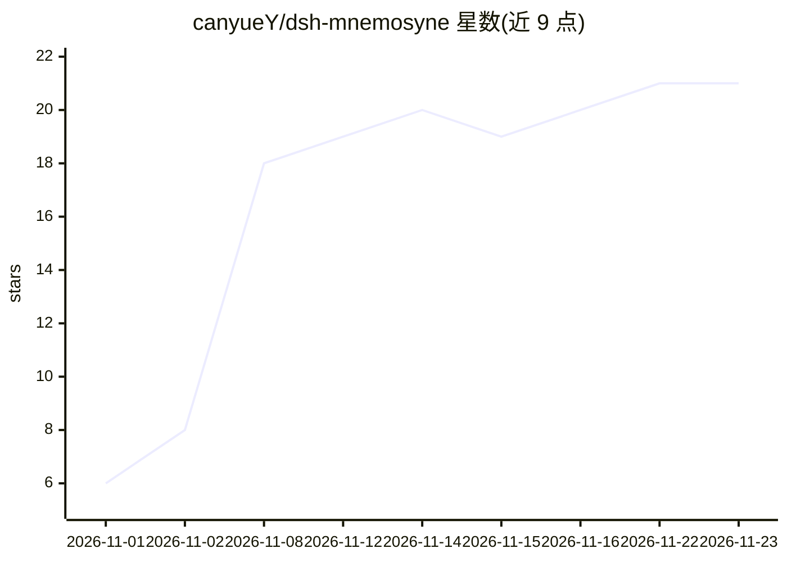

# canyueY/dsh-mnemosyne

⭐ 21 · Python · Apache-2.0 · 推送 2026-11-19 · [GitHub](https://github.com/canyueY/dsh-mnemosyne) · [官网](https://github.com/canyueY/dsh-mnemosyne) · 个人维护 · 中文 README

**面向 AI Agent 的模块化记忆与认知基础设施（含 DSH 插件适配层）**

Mnemosyne 2.0 是面向 AI Agent 的记忆基础设施：以独立运行的 Mnemosyne Node（Python FastAPI Service）为核心，提供证据管理、记忆生命周期（Observation→Evidence→Memory→Evolution）、认知演化（同化/顺应/冲突）与反馈学习机制；数据以 SQLite Memory Bank 持久化，一个 Node 对应一个 Memory Bank。仓库同时包含 DSH（DeepSeek Harness）插件适配层，用于启动守护 Node 并注册 memory_* 工具。当前 2.0 统一版为仓库合并与版本收敛，认知自演化等能力属于 Roadmap 未交付；语义检索为可插拔能力，默认轻量 hashed_embedding。

## 筛选速览

| 维度 | 判定 | 备注 |
|---|---|---|
| AI 角色 | `ai-ecosystem` | LLM/agent 周边工具 |
| 许可风险 | `permissive` | Apache-2.0 |
| 部署形态 | `library` | 以包/库形式分发 |
| 模型依赖 | locked-api |  |
| 硬件要求 | — | 无带数字的原话,不猜 |
| 安装摩擦 | `low` | 无编译、无系统依赖或容器化 |
| 成熟度 | — | 结构信号不足 |

## 能力要点

- 独立 Mnemosyne Node + Python FastAPI Service，SQLite Memory Bank 持久化
- 记忆生命周期：Observation→Evidence→Candidate→Memory→Review→Evolution
- 反馈信号分级（user_explicit/outcome/self_eval）与 Schema Evolution 预览确认机制
- 提供 REST /api/v1、SDK、MCP 接入接口与 DSH 插件适配层

## 适用场景

- 为长期运行的 AI Agent 提供可治理的长期记忆与证据追溯
- 通过 DSH 插件给 DeepSeek Harness 宿主接入记忆能力
- 跨项目用 Memory Bank 隔离记忆，管理个人认知的权威来源

## 场景标签

`Agent 记忆` · 领域:Agent 开发

## 证据(README 行号)

> L45: Mnemosyne 以独立运行、模块化设计、可追溯数据和可组合服务为核心原则。它可以作为独立记忆系统运行，也可以通过适配器接入 DeepSeek Harness（DSH）等 Agent 宿主。
> L225: |项目类型|AI Agent 记忆基础设施|
> L233: 它不负责替代模型推理、工具执行、任务编排或 Agent 人格，而是为这些系统提供可复用的记忆能力。

## 星数曲线

2026-11-01 6 → 2026-11-23 21（+15）

---
*卡片 v1 · prompt 1.4 · 生成 2026-11-18 · 置信度 mid · 依据 README sha `2310bcf75910` · [字段定义](../../DATASET.md)*
