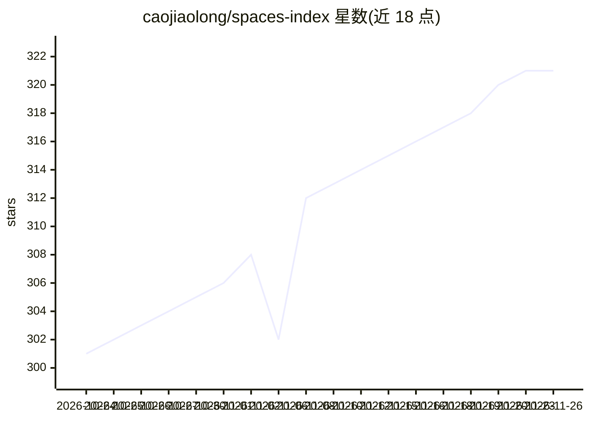

# caojiaolong/spaces-index

⭐ 321 · HTML · NOASSERTION · 推送 2026-11-25 · [GitHub](https://github.com/caojiaolong/spaces-index) · [官网](https://caojiaolong.github.io/spaces-index/) · 个人维护 · 中文 README

**苏剑林「科学空间」博客的主题化文章索引与原文 Markdown 库**

对苏剑林「科学空间」博客进行自动抓取与索引的非官方知识库，收录 1348 篇文章元数据，按 17 个知识主题、56 个系列做规则分类，支持标题/标签/系列检索、系列顺序阅读与阅读进度记录（仅存浏览器本地）。提供忠于原文的 Markdown 转换，正文经构建时校验，保留署名与 CC BY-NC-ND 2.5 CN 许可说明。标注为非官方、非商业项目；跨文章正文检索与知识问答等功能声明尚未实现。

## 筛选速览

| 维度 | 判定 | 备注 |
|---|---|---|
| AI 角色 | `ai-knowledge` | 知识聚合/清单类 |
| 许可风险 | `none` | NOASSERTION |
| 部署形态 | `None` |  |
| 模型依赖 | — | README 未给出锁定关系 |
| 硬件要求 | — | 无带数字的原话,不猜 |
| 安装摩擦 | `low` | 无编译、无系统依赖或容器化 |
| 成熟度 | — | 结构信号不足 |

## 能力要点

- 收录 1348 篇文章，按 17 个主题与 56 个系列分类
- 提供经校验的原文 Markdown，保留 LaTeX 公式、代码与出处
- 支持文章检索、主题漫游与系列书架阅读进度跟踪
- 一键复制 Markdown 以便粘贴到 AI 对话中提问

## 适用场景

- 找回读过但想不起标题的科学空间文章
- 按系列顺序系统学习 Transformer、优化器等主题
- 复制带公式的原文 Markdown 交给 AI 解释推导

## 场景标签

`精选清单` · 领域:学习与行业

## 证据(README 行号)

> L17:  苏剑林「科学空间」的非官方、非商业知识库 · 主题检索 · 系列阅读 · AI 友好的原文 Markdown
> L23: **spaces-index 希望把找文章的时间，留给理解文章。** 它将苏剑林老师在科学空间的文章整理为持续更新的主题与系列索引，并提供忠于原文的 Markdown。从 Transformer、扩散模型、优化算法到数学、自然科学
> L25: 另一个核心目的，是做 **AI 友好的原文转换**：把文章的正文、公式和代码保存在结构清晰的 Markdown 中。遇到读不懂的地方，一键复制原文到你选择的 AI，带着完整上下文提问，把精力放在理解推导上。

## 星数曲线

2026-10-24 301 → 2026-11-26 321（+20）

---
*卡片 v1 · prompt 1.4 · 生成 2026-11-25 · 置信度 high · 依据 README sha `d79e3f563cb0` · [字段定义](../../DATASET.md)*
