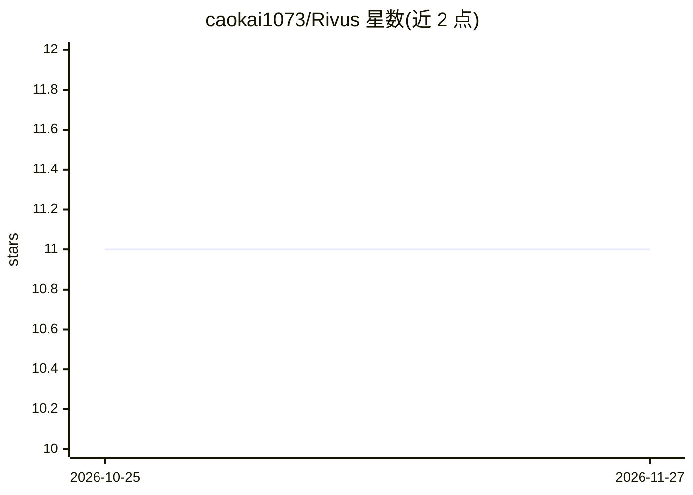

# caokai1073/Rivus

⭐ 11 · HTML · Apache-2.0 · 推送 2026-06-12 · [GitHub](https://github.com/caokai1073/Rivus) · 个人维护 · 中文 README

**本地 AI 个人知识库：离线问答多格式文档**

基于 pywebview + FastAPI + SQLite 的桌面个人知识库应用，支持导入网页 URL、PDF、Word、Excel、Markdown 与纯文本，通过混合 RAG（BAAI/bge-m3 向量检索 + BM25 全文检索 + RRF 融合 + 查询分解）以 AI 回答文档相关问题。本地模型经 Ollama 一键运行，可完全离线；也可接入 OpenAI、Anthropic、DeepSeek 等云端 API，云端模式下仅发送问题与检索片段。文档与向量全部存于本机单个 SQLite 文件，支持 SSH 隧道连远端 GPU 推理。

## 筛选速览

| 维度 | 判定 | 备注 |
|---|---|---|
| AI 角色 | `ai-native` | 本体是模型或模型工具 |
| 许可风险 | `permissive` | Apache-2.0 |
| 部署形态 | `desktop` | 安装包/桌面程序 |
| 模型依赖 | local-ok | 支持本地模型 |
| 硬件要求 | `gpu-8g` | |
| 安装摩擦 | `medium` | 含编译或系统依赖之一 |
| 成熟度 | — | 结构信号不足 |

## 能力要点

- 混合 RAG：bge-m3 向量检索 + BM25 + RRF 融合 + 查询分解
- 本地模型经 Ollama 一键下载运行，支持完全离线
- 云端模型采用 Tool-Use Agent 自主决定检索次数
- SSH 隧道连接远端 GPU，本地文档远端推理

## 适用场景

- 把 PDF、网页、笔记整理成可问答的个人知识库
- 在无网环境下离线检索和问答自己的文档
- 通过 SSH 用实验室服务器 GPU 跑本地模型问答

## 场景标签

`知识库管理` `RAG` `文档问答` · 领域:知识与检索

## 证据(README 行号)

> L28: It's a **desktop app** that lets you build a personal knowledge base from your documents, web pages, PDFs, and note
> L46: **Local models (Ollama) — Query Decomposition + Hybrid RAG**
> L180: **Key design choices:**

## 星数曲线

2026-10-25 11 → 2026-11-27 11（+0）

---
*卡片 v1 · prompt 1.4 · 生成 2026-11-18 · 置信度 high · 依据 README sha `3a4c2817ac3e` · [字段定义](../../DATASET.md)*
