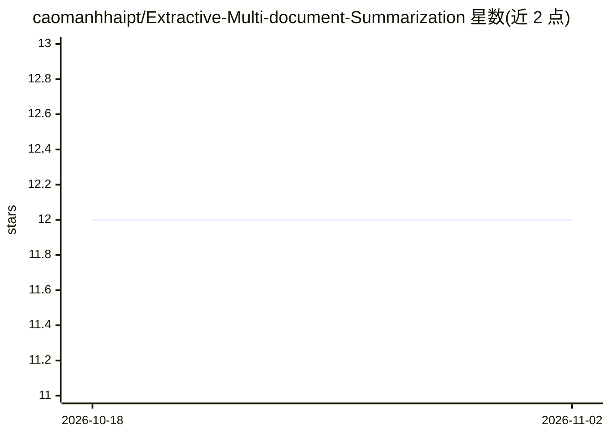

# caomanhhaipt/Extractive-Multi-document-Summarization

⭐ 12 · Perl · 推送 2026-04-18 · [GitHub](https://github.com/caomanhhaipt/Extractive-Multi-document-Summarization) · 个人维护

**多文档抽取式摘要研究代码：K-means+质心+MMR+句位置**

论文配套的 Python 研究实现，复现作者提出的抽取式多文档摘要方法：以 K-means 聚类为基础，结合质心法、最大边际相关性（MMR）与句子位置特征选取摘要句。使用 DUC2007 数据集，通过 pyrouge 脚本评估结果，也提供从新数据生成摘要的入口脚本。安装方式为克隆仓库并 pip 安装 requirements.txt 依赖，无打包发布。

## 筛选速览

| 维度 | 判定 | 备注 |
|---|---|---|
| AI 角色 | `ai-native` | 本体是模型或模型工具 |
| 许可风险 | `none` | — |
| 部署形态 | `library` | 以包/库形式分发 |
| 模型依赖 | — | README 未给出锁定关系 |
| 硬件要求 | — | 无带数字的原话,不猜 |
| 安装摩擦 | `low` | 无编译、无系统依赖或容器化 |
| 成熟度 | — | 结构信号不足 |

## 能力要点

- K-means 聚类结合质心法、MMR 与句子位置特征
- 支持在 DUC2007 数据集上生成摘要并用 ROUGE 评估
- 提供对新数据生成摘要的命令行入口

## 适用场景

- 复现论文中的多文档摘要实验结果
- 在 DUC2007 上跑 ROUGE 评估
- 对自己的文档数据生成抽取式摘要

## 场景标签

 · 领域:NLP/文本摘要

## 证据(README 行号)

> L3: Python implementation of Extractive Multi-document Summarization as described in Extractive Multi-document Summariza
> L17: We propose an approach to multi-document summarization based on k-means clustering algorithm, combining with centro

## 星数曲线

2026-10-18 12 → 2026-11-02 12（+0）

---
*卡片 v1 · prompt 1.4 · 生成 2026-11-01 · 置信度 mid · 依据 README sha `685da28ff962` · [字段定义](../../DATASET.md)*
