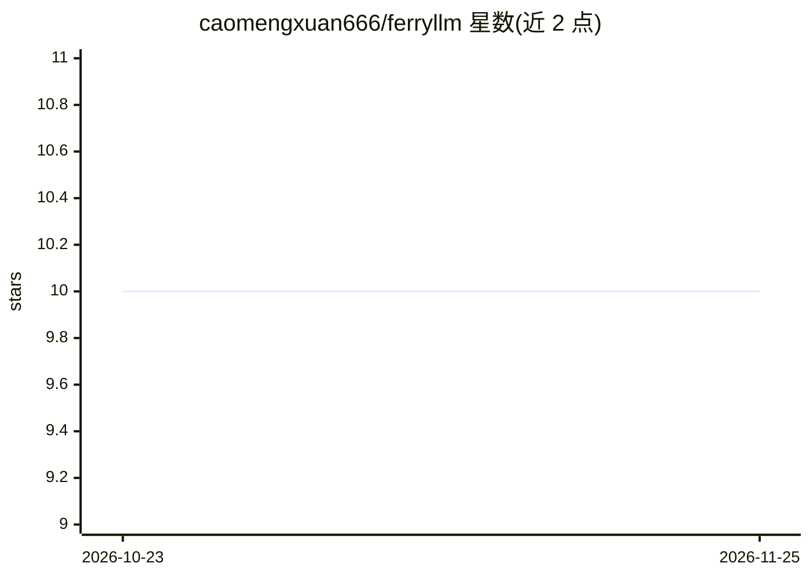

# caomengxuan666/ferryllm

⭐ 10 · Rust · MIT · 推送 2026-08-27 · [GitHub](https://github.com/caomengxuan666/ferryllm) · 个人维护 · 中文 README

**面向 Codex/Claude Code 等客户端的本地 LLM 网关与桌面控制面板**

以 Rust 网关为核心、GUI 为主工作流的本地 LLM 协议中间件：在 OpenAI 兼容、OpenAI Responses 与 Anthropic 三种协议间做 N+M 路由转换，支持模型名重写与别名、SSE 流式与工具调用透传、prompt-cache 键稳定化、可配置的 reasoning 策略（preserve/fill/cap/force）。桌面端提供 Dashboard、Providers、Launcher、Usage Logs 页面，可绑定工作区并启动 Codex、Claude Code、OpenCode、VS Code；CLI 与 GUI 共享同一引擎。MIT 许可。

## 筛选速览

| 维度 | 判定 | 备注 |
|---|---|---|
| AI 角色 | `ai-ecosystem` | LLM/agent 周边工具 |
| 许可风险 | `permissive` | MIT |
| 部署形态 | `desktop` | 安装包/桌面程序 |
| 模型依赖 | locked-api |  |
| 硬件要求 | — | 无带数字的原话,不猜 |
| 安装摩擦 | `medium` | 含编译或系统依赖之一 |
| 成熟度 | — | 结构信号不足 |

## 能力要点

- N+M 中间表示路由：客户端协议经 IR 转换到上游 provider 协议
- 同时暴露 /v1/chat/completions、/v1/responses、/v1/messages 三类端点
- Tauri 桌面面板：provider 预设、模型发现、指标仪表盘、启动器
- 可配置 reasoning 策略与 prompt-cache 键稳定化，暴露 /metrics

## 适用场景

- 把 Claude Code 接到 OpenAI 兼容后端
- 在本地用 GUI 管理多个 LLM provider 与模型映射
- 为多个客户端协议提供统一网关入口
- 通过 /metrics 观测延迟、缓存命中与各 provider 用量

## 场景标签

`模型网关` · 领域:Agent 开发

## 证据(README 行号)

> L10: ferryllm is a native desktop control panel backed by a Rust LLM gateway. The GUI is the primary workflow: configure
> L12: The CLI and GUI are thin shells around the same core gateway engine. Protocol translation, routing, prompt-cache ha
> L24: - Forwards to OpenAI-compatible, OpenAI Responses, Anthropic, or optional Gemini backend adapters

## 星数曲线

2026-10-23 10 → 2026-11-25 10（+0）

---
*卡片 v1 · prompt 1.4 · 生成 2026-11-19 · 置信度 high · 依据 README sha `63f8b4aab762` · [字段定义](../../DATASET.md)*
