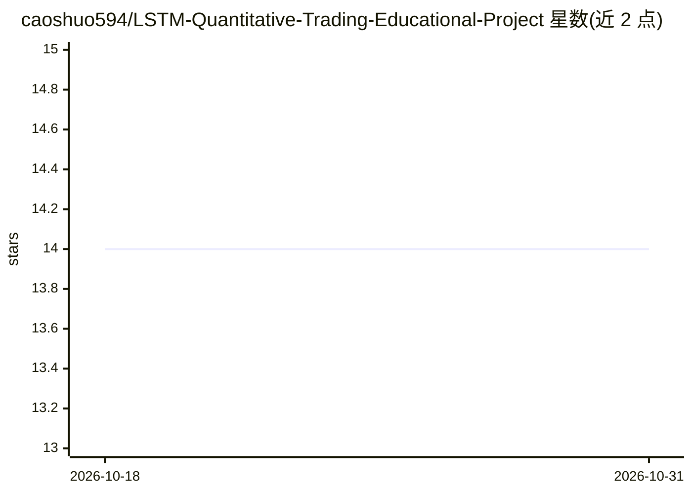

# caoshuo594/LSTM-Quantitative-Trading-Educational-Project

⭐ 14 · Python · MIT · 推送 2026-06-05 · [GitHub](https://github.com/caoshuo594/LSTM-Quantitative-Trading-Educational-Project) · [官网](https://github.com/caoshuo594/LSTM) · 个人维护

**教学项目：用 LSTM 训练 EURUSD 预测模型并经 ONNX 部署到 MT5**

面向机器学习学生、量化交易初学者与 MT5 开发者的端到端教学项目：从 MetaTrader 5 获取 EURUSD H1 历史数据，用 PyTorch 训练 LSTM（10 时间步×5 特征，约 2,040 参数）预测下一根 K 线收盘价，经早停与验证集监控后导出为约 10 KB 的 ONNX 模型，在 MQL5 Expert Advisor 内实时推理并按价格阈值生成买卖信号，支持回测。支持 CUDA GPU 加速。声明仅供教育与研究用途，不构成投资建议。

## 筛选速览

| 维度 | 判定 | 备注 |
|---|---|---|
| AI 角色 | `ai-native` | 本体是模型或模型工具 |
| 许可风险 | `permissive` | MIT |
| 部署形态 | `None` |  |
| 模型依赖 | — | README 未给出锁定关系 |
| 硬件要求 | — | 无带数字的原话,不猜 |
| 安装摩擦 | `medium` | 含编译或系统依赖之一 |
| 成熟度 | — | 结构信号不足 |

## 能力要点

- LSTM 模型从训练到 ONNX 导出的完整流水线
- MT5 Expert Advisor 内原生实时推理与交易信号生成
- 约 10 KB 模型、推理延迟 <1 ms
- 支持 CUDA GPU 加速与早停防过拟合

## 适用场景

- 学习深度学习在金融时序预测中的完整流程
- 了解如何将 PyTorch 模型导出 ONNX 并接入 MT5 EA
- AI 驱动外汇算法交易的入门实践

## 场景标签

`金融量化` `教程课程` · 领域:学习与行业

## 证据(README 行号)

> L13: This project provides a complete end-to-end quantitative trading workflow based on a Long Short-Term Memory (LSTM) 
> L15: The repository is designed as an educational resource for developers, students, quantitative traders, and machine l
> L31: * LSTM neural network for time-series prediction

## 星数曲线

2026-10-18 14 → 2026-10-31 14（+0）

---
*卡片 v1 · prompt 1.4 · 生成 2026-10-31 · 置信度 high · 依据 README sha `d4e7ff5561a5` · [字段定义](../../DATASET.md)*
