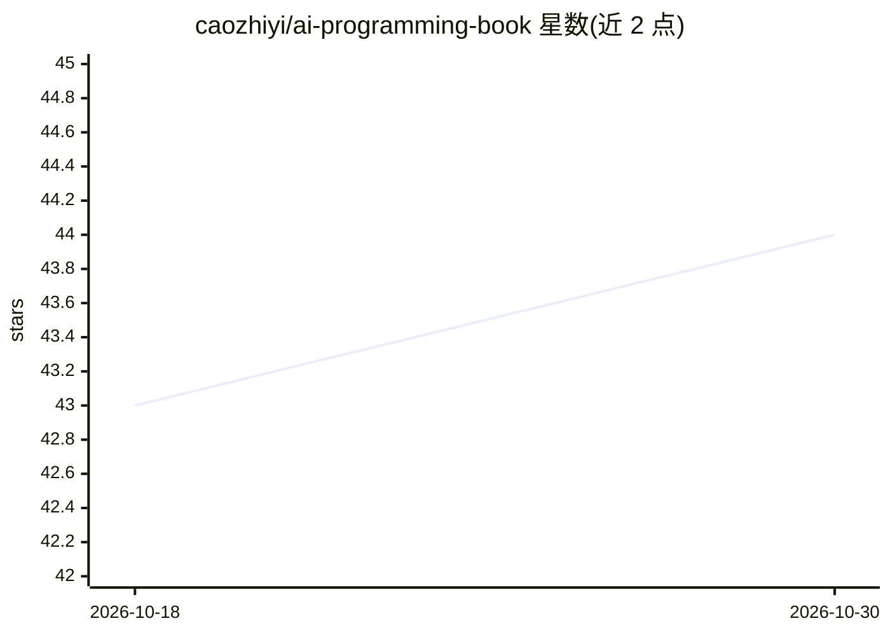

# caozhiyi/ai-programming-book

⭐ 44 · NOASSERTION · 推送 2026-07-19 · [GitHub](https://github.com/caozhiyi/ai-programming-book) · 个人维护 · 中文 README

**从第一性原理推导 AI 编程系统的开源技术书（4 部分 15 章）**

面向已在使用 AI 编程工具的工程师与团队技术负责人的免费在线书籍。全书不做具体工具教程，而是从大模型的物理约束（如 attention 的 O(n²) 成本）出发逐步推导上下文窗口、Agent、MCP、RAG、记忆与上下文工程、团队组织等主题的成因与边界。共 4 部分 15 章及 4 篇随笔附录与 3 个参考附录，配手工 SVG 结构图。提供 mkdocs 在线版与可选的本地构建方式，采用 CC BY-NC-SA 4. 许可，禁止商业使用。

## 筛选速览

| 维度 | 判定 | 备注 |
|---|---|---|
| AI 角色 | `ai-knowledge` | 知识聚合/清单类 |
| 许可风险 | `none` | NOASSERTION |
| 部署形态 | `library` | 以包/库形式分发 |
| 模型依赖 | — | README 未给出锁定关系 |
| 硬件要求 | — | 无带数字的原话,不猜 |
| 安装摩擦 | `low` | 无编译、无系统依赖或容器化 |
| 成熟度 | `idea` | |

## 能力要点

- 4 部分 15 章的递进式结构，每部分是下一部分的前置
- 每章结论由底层原理推导（上下文窗口、Agent 架构、RAG 权衡等）
- 第 7 章专门讨论 Agent 失败模式与边界
- 附录含速查卡片与 30 天实践路径

## 适用场景

- 理解 RAG、Agent、MCP 等概念背后的原理与适用边界
- 为团队选型 AI 编程工具或设计 agent 架构前建立判断框架
- 按问题跳读：Agent 失败排查、RAG vs 微调选型等

## 场景标签

`教程课程` · 领域:学习与行业

## 证据(README 行号)

> L10:  📖 A first-principles book for serious users of AI coding tools · Free to read online
> L31: > **Every concept here isn't a product feature dropped from the sky — it's a consequence derived, step by step, fro

## 星数曲线

2026-10-18 43 → 2026-10-30 44（+1）

---
*卡片 v1 · prompt 1.4 · 生成 2026-10-25 · 置信度 mid · 依据 README sha `bf84c5725926` · [字段定义](../../DATASET.md)*
