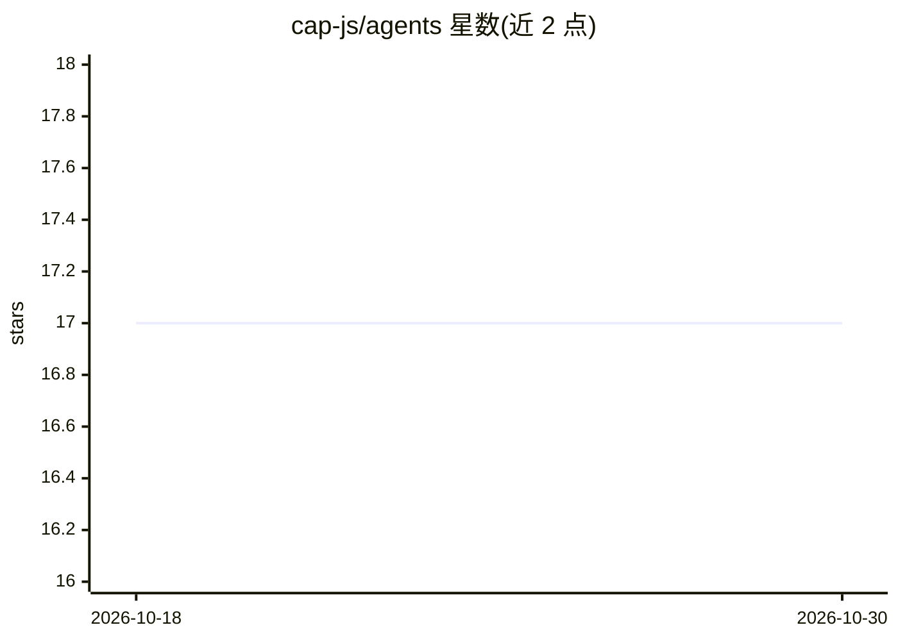

# cap-js/agents

⭐ 17 · JavaScript · Apache-2.0 · 推送 2026-10-29 · [GitHub](https://github.com/cap-js/agents) · 组织维护

**SAP CAP 的 Node.js 插件：基于 A2A 协议构建 agent**

SAP Cloud Application Programming Model (CAP) 的 CDS 插件，面向 Node.js，用于构建基于 A2A 协议的 agent。具体配置与使用方法指向官方文档，README 本身未给出安装命令或功能细节。由 SAP SE 以开源方式维护，接受 GitHub issue 反馈与社区贡献，采用 REUSE 规范管理许可与第三方组件信息。适合使用 SAP CAP 技术栈并需要接入 agent 协议的开发者。

## 筛选速览

| 维度 | 判定 | 备注 |
|---|---|---|
| AI 角色 | `ai-ecosystem` | LLM/agent 周边工具 |
| 许可风险 | `permissive` | Apache-2.0 |
| 部署形态 | `None` |  |
| 模型依赖 | — | README 未给出锁定关系 |
| 硬件要求 | — | 无带数字的原话,不猜 |
| 安装摩擦 | `low` | 无编译、无系统依赖或容器化 |
| 成熟度 | — | 结构信号不足 |

## 能力要点

- CDS 插件形式，基于 A2A 协议构建 agent
- 面向 Node.js 的 SAP CAP 生态扩展
- 详细文档托管于官方文档站点

## 适用场景

- 在 SAP CAP 项目中添加 A2A 协议的 agent 能力
- CAP 技术栈开发者构建与协议对接的 agent

## 场景标签

`Agent 框架` · 领域:Agent 开发

## 证据(README 行号)

> L3: # SAP Cloud Application Programming Model, agent development plugin for Node.js
> L7: CDS plugin for building agents based on the A2A protocol.

## 星数曲线

2026-10-18 17 → 2026-10-30 17（+0）

---
*卡片 v1 · prompt 1.4 · 生成 2026-10-29 · 置信度 mid · 依据 README sha `4fb755acd1c0` · [字段定义](../../DATASET.md)*
