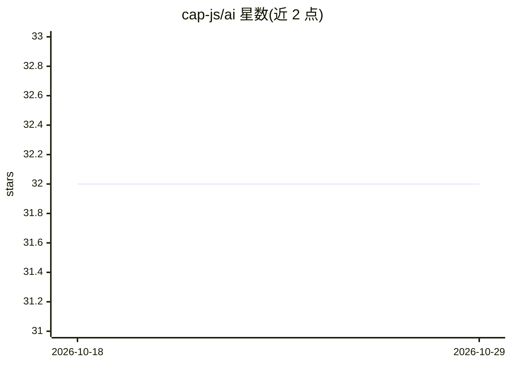

# cap-js/ai

⭐ 32 · JavaScript · Apache-2.0 · 推送 2026-10-28 · [GitHub](https://github.com/cap-js/ai) · 组织维护

**CAP 应用的 AI 插件：AI Core 推荐、集成与本地向量嵌入**

面向 SAP CAP（Node.js）应用的 CDS 插件，提供三项功能：基于 SAP-RPT-1 的值帮助字段推荐（需生产环境绑定 SAP AI Core，本地用 mock 实现做 UI 冒烟测试）；AICore CAP 服务，用于管理 SAP AI Core 的资源组、部署与配置；以及实验性的 SQLite 本地向量嵌入——重定向标准 sqlite 数据库，使 VECTOR_EMBEDDING 与向量函数通过本地 ONNX 模型运行，无需外部服务，与 SAP HANA 查询代码保持不变。本地嵌入依赖 @cap-js/sqlite ^3.1 与 @sap/cds ^10.1，默认模型为 all-MiniLM-L6-v2，实验功能预期有破坏性变更。

## 筛选速览

| 维度 | 判定 | 备注 |
|---|---|---|
| AI 角色 | `ai-ecosystem` | LLM/agent 周边工具 |
| 许可风险 | `permissive` | Apache-2.0 |
| 部署形态 | `None` |  |
| 模型依赖 | — | README 未给出锁定关系 |
| 硬件要求 | — | 无带数字的原话,不猜 |
| 安装摩擦 | `low` | 无编译、无系统依赖或容器化 |
| 成熟度 | `idea` | |

## 能力要点

- SAP-RPT-1 推荐自动加入值帮助字段，支持 @UI.RecommendationState 按字段开关
- AICore CAP 服务管理 SAP AI Core 的资源组、部署与配置
- SQLite 本地向量嵌入运行真实 ONNX 模型，代码与 SAP HANA 保持一致
- 本地模型缓存在 ~/.cds/models，可经 cds.requires.db.embedding.model 固定模型

## 适用场景

- 为 CAP 应用的表单字段自动生成推荐值
- 在 CAP 应用中程序化管理 SAP AI Core 部署
- 本地 SQLite 上开发测试语义搜索，生产切换 SAP HANA 向量引擎

## 场景标签

`语义搜索` · 领域:知识与检索

## 证据(README 行号)

> L5: `@cap-js/ai` adds UI recommendations powered by SAP AI Core, simplified access to SAP AI Core resources, and vector 
> L33: The plugin provides an `AICore` CAP service for managing resource groups, deployments, and configurations:
> L50: `@cap-js/ai` redirects the standard `sqlite` database so that `VECTOR_EMBEDDING` and the vector functions run local

## 星数曲线

2026-10-18 32 → 2026-10-29 32（+0）

---
*卡片 v1 · prompt 1.4 · 生成 2026-10-26 · 置信度 high · 依据 README sha `667dae4539c4` · [字段定义](../../DATASET.md)*
