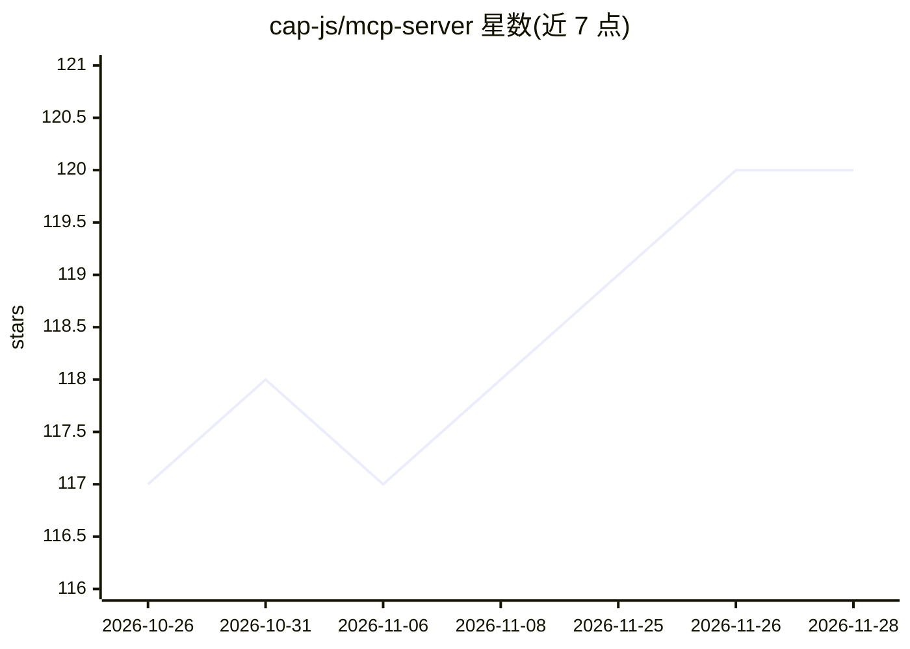

# cap-js/mcp-server

⭐ 120 · JavaScript · Apache-2.0 · 推送 2026-11-19 · [GitHub](https://github.com/cap-js/mcp-server) · [官网](https://cap.cloud.sap/docs) · 组织维护

**供 AI 编码助手接入的 CAP 应用开发 MCP 服务器**

面向 SAP Cloud Application Programming Model（CAP）的 MCP 服务器，用于 AI 辅助开发 CAP 应用（agentic coding）。提供两个工具：search_docs 基于向量嵌入在本地对预处理过的 CAP 文档做语义检索；search_model 对编译后的 CDS 模型定义名称做模糊搜索，覆盖实体、注解与 HTTP 端点。可配置进 Claude Code、VS Code、OpenAI Codex、opencode 等 MCP 客户端，也可全局安装后通过 cds-mcp CLI 直接调用工具或生成自定义嵌入。环境变量部分声明为实验性。

## 筛选速览

| 维度 | 判定 | 备注 |
|---|---|---|
| AI 角色 | `ai-ecosystem` | LLM/agent 周边工具 |
| 许可风险 | `permissive` | Apache-2.0 |
| 部署形态 | `library` | 以包/库形式分发 |
| 模型依赖 | — | README 未给出锁定关系 |
| 硬件要求 | — | 无带数字的原话,不猜 |
| 安装摩擦 | `low` | 无编译、无系统依赖或容器化 |
| 成熟度 | — | 结构信号不足 |

## 能力要点

- search_docs 本地向量检索 CAP 文档，无需关键词精确匹配
- search_model 对编译后的 CDS 模型定义做模糊搜索
- 提供 npx 启动、npm 全局安装与 cds-mcp CLI 三种使用方式
- 支持自定义嵌入模型与本地 cross-encoder 重排（实验性）

## 适用场景

- 让 AI 编码助手回答项目中 CDS 服务与实体关系的问题
- 修改 CDS 模型或使用 CAP API 前让 AI 先检索官方文档
- 本地生成并使用自定义 CAP 文档嵌入

## 场景标签

`编码 Agent` · 领域:编码与开发

## 证据(README 行号)

> L7: A Model Context Protocol (MCP) server for the SAP Cloud Application Programming Model (CAP).
> L8: Use it for AI-assisted development of CAP applications (_agentic coding_).
> L23: Configure your MCP client (Cline, opencode, Claude Code, GitHub Copilot, etc.) to start the server using the comman

## 星数曲线

2026-10-26 117 → 2026-11-28 120（+3）

---
*卡片 v1 · prompt 1.4 · 生成 2026-11-28 · 置信度 high · 依据 README sha `060272d4d1e5` · [字段定义](../../DATASET.md)*
