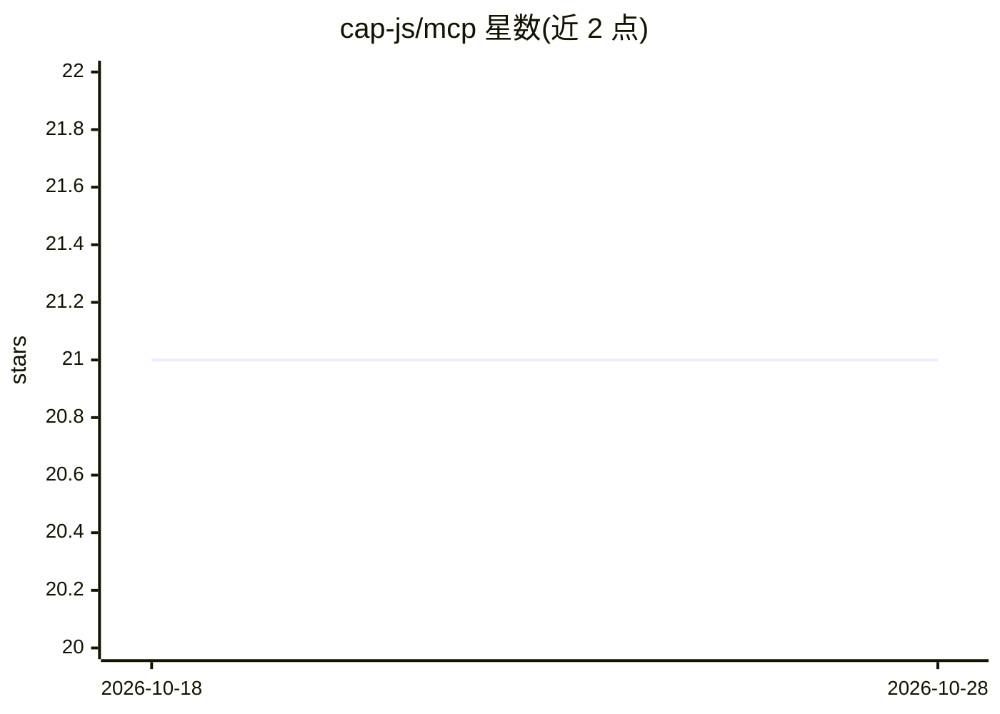

# cap-js/mcp

⭐ 21 · JavaScript · Apache-2.0 · 推送 2026-10-28 · [GitHub](https://github.com/cap-js/mcp) · 组织维护

**将 CAP 服务通过 MCP 协议暴露给 AI agent 的适配器插件**

SAP CAP（Cloud Application Programming Model）的协议适配器插件，把 CAP 服务通过 Model Context Protocol 暴露，供 AI agent 以工具方式消费。提供 query 与 call 等通用工具，并支持特性开关：按 action/function 暴露专用工具、以服务名前缀避免多 MCP 服务器连接时的工具名冲突、切换 CQL/CQN 查询输入格式。可通过 @mcp.instructions 注解自定义发送给 agent 的服务器指令，支持 i18n 引用。需注意 SAP API Policy 对暴露 SAP 数据的约束。

## 筛选速览

| 维度 | 判定 | 备注 |
|---|---|---|
| AI 角色 | `ai-ecosystem` | LLM/agent 周边工具 |
| 许可风险 | `permissive` | Apache-2.0 |
| 部署形态 | `None` |  |
| 模型依赖 | — | README 未给出锁定关系 |
| 硬件要求 | — | 无带数字的原话,不猜 |
| 安装摩擦 | `low` | 无编译、无系统依赖或容器化 |
| 成熟度 | — | 结构信号不足 |

## 能力要点

- 把 CAP 服务以 MCP 工具形式暴露给 agent
- per_action_tool 将每个 action/function 暴露为专用工具
- 工具名服务前缀避免多 MCP 服务器连接冲突
- @mcp.instructions 注解自定义 agent 初始化指令，支持 i18n

## 适用场景

- 让 AI agent 查询和调用已有的 CAP 业务服务
- 多个 MCP 服务器共存时避免工具命名冲突
- 通过注解为 agent 提供领域特定的使用说明

## 场景标签

`Agent 框架` · 领域:Agent 开发

## 证据(README 行号)

> L5: This is a protocol adapter for the Model Context Protocol to expose CAP services for agent consumption. For more inf
> L25: |`per_action_tool`|`false`|Expose each action/function as its own dedicated tool instead of the generic `call` tool

## 星数曲线

2026-10-18 21 → 2026-10-28 21（+0）

---
*卡片 v1 · prompt 1.4 · 生成 2026-10-28 · 置信度 high · 依据 README sha `c34c3c374765` · [字段定义](../../DATASET.md)*
