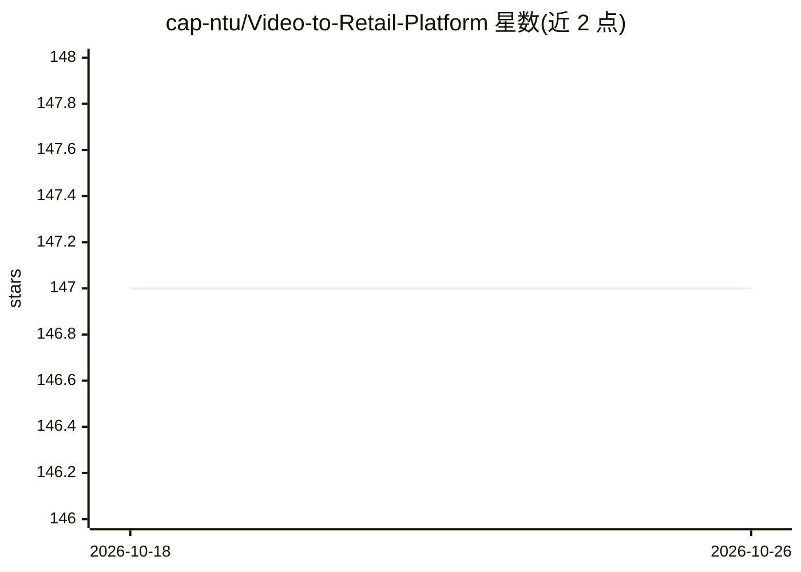

# cap-ntu/Video-to-Retail-Platform

⭐ 147 · Python · Apache-2.0 · 推送 2026-02-23 · [GitHub](https://github.com/cap-ntu/Video-to-Retail-Platform) · 组织维护

**视频-商品-广告多模态分析系统，支撑推荐与视频检索等应用**

Hysia 是基于多模态学习的视频、商品与广告分析系统（Hysia Video to Retail Platform），由 NTU Cloud Application and Platform Lab（Yonggang Wen 教授）维护。功能覆盖场景/物体/人脸检测与识别、多模态数据预处理与结果对齐存储，并提供智能广告插入、内容-商品匹配等下游应用及可视化测试床（可单独安装）。通过 Docker 镜像部署，支持在 device_placement.yml 中为解码器与各模型服务分配 CPU/CUDA 设备。工作已被 ACMMM2020 收录为开源竞赛论文；README 声明项目处于活跃开发中。

## 筛选速览

| 维度 | 判定 | 备注 |
|---|---|---|
| AI 角色 | `ai-native` | 本体是模型或模型工具 |
| 许可风险 | `permissive` | Apache-2.0 |
| 部署形态 | `self-host` | docker 或自建部署 |
| 模型依赖 | — | README 未给出锁定关系 |
| 硬件要求 | — | 无带数字的原话,不猜 |
| 安装摩擦 | `low` | 无编译、无系统依赖或容器化 |
| 成熟度 | `idea` | |

## 能力要点

- 多模态视频分析：场景/物体/人脸检测与识别
- 下游应用：智能广告插入、内容-商品匹配
- 可视化多模态测试床，可单独安装
- Docker 部署，可按服务分配 CPU/CUDA 设备

## 适用场景

- 上传视频并选择模型进行处理与结果可视化
- 以图或文本检索视频场景
- 在视频中插入商品广告并查看插入结果
- 构建商品推荐、视频检索等下游应用

## 场景标签

`人脸识别` `多模态` `目标检测` · 领域:感知与多模态

## 证据(README 行号)

> L9: An intelligent multimodal-learning based system for video, product and ads analysis. You can build various downstrea
> L52: - Multimodal learning-based video analysis:

## 星数曲线

2026-10-18 147 → 2026-10-26 147（+0）

---
*卡片 v1 · prompt 1.4 · 生成 2026-10-22 · 置信度 high · 依据 README sha `73944461f7ee` · [字段定义](../../DATASET.md)*
