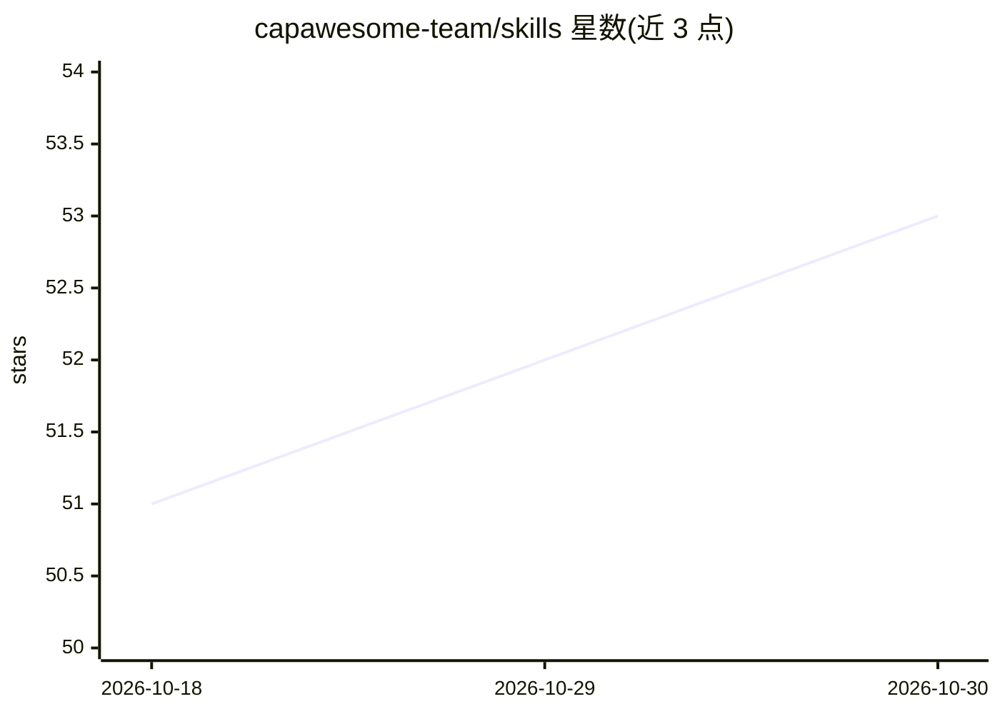

# capawesome-team/skills

⭐ 53 · Python · MIT · 推送 2026-10-20 · [GitHub](https://github.com/capawesome-team/skills) · 组织维护

**面向 AI agent 的 Capacitor/Ionic 开发技能集与 MCP 文档服务器**

capawesome-team 维护的 agent skills 集合，覆盖 Capacitor 应用创建、跨大版本升级（4→8）、160+ 插件安装配置、推送/内购、Ionic Framework 开发与迁移等场景；指令按机器可执行格式编写，可检测并优先使用托管的三个 MCP 服务器获取实时文档，未连接时回退到内置参考文件。通过 npx skills 或 Claude Code 插件市场安装，供使用 Claude Code、Cursor 等 MCP 客户端的开发者在其 agent 中调用。

## 筛选速览

| 维度 | 判定 | 备注 |
|---|---|---|
| AI 角色 | `ai-knowledge` | 知识聚合/清单类 |
| 许可风险 | `permissive` | MIT |
| 部署形态 | `library` | 以包/库形式分发 |
| 模型依赖 | — | README 未给出锁定关系 |
| 硬件要求 | — | 无带数字的原话,不猜 |
| 安装摩擦 | `low` | 无编译、无系统依赖或容器化 |
| 成熟度 | — | 结构信号不足 |

## 能力要点

- 覆盖 Capacitor 升级、插件配置、Ionic 开发与迁移的技能清单
- 配套三个托管 MCP 服务器，文档直连源、无需本地维护
- 技能检测 MCP 可用性并优先使用，离线时回退内置参考
- 支持 npx skills 一键安装全部技能或按插件单独安装

## 适用场景

- 让 AI agent 代为升级 Capacitor 应用或插件到新大版本
- 通过对话安装配置 Capacitor 插件（推送、内购、文件选择等）
- 从 Ionic Appflow、Capgo 或 Ionic Enterprise SDK 迁移到 Capawesome Cloud
- 为 MCP 客户端接入 Capacitor/Ionic 实时文档服务器

## 场景标签

`编码 Agent` · 领域:编码与开发

## 证据(README 行号)

> L5: Agent skills for interacting with Capawesome, Capacitor and the Ionic Framework.
> L15: - 🤖 **Agent-optimized**: Every instruction is unambiguous and machine-actionable for AI agents.
> L58: ||MCP Servers|Skills|

## 星数曲线

2026-10-18 51 → 2026-10-30 53（+2）

---
*卡片 v1 · prompt 1.4 · 生成 2026-10-24 · 置信度 high · 依据 README sha `60a1dd22c083` · [字段定义](../../DATASET.md)*
