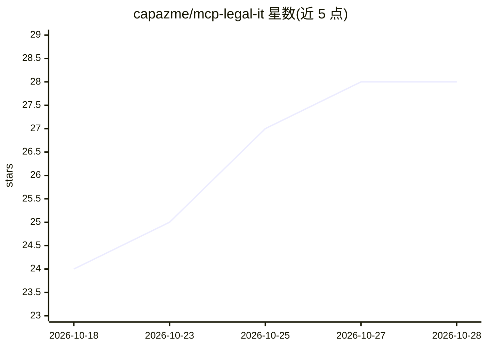

# capazme/mcp-legal-it

⭐ 28 · Python · Apache-2.0 · 推送 2026-10-26 · [GitHub](https://github.com/capazme/mcp-legal-it) · [官网](https://capazme.github.io/mcp-legal-it/) · 个人维护

**意大利法律 MCP 服务器：为 Claude 提供 228 个法律工具**

面向意大利法律从业者的 Model Context Protocol 服务器，以 Claude Desktop 插件或 Claude Code 插件形式安装，本地运行（stdio/HTTP）。提供 228 个工具，分 34 个模块：法规查询（Normattiva/EUR-Lex/Brocardi）、各级法院判例全文检索、法律计算（利息、ISTAT 重估、IRPEF、继承、赔偿等）、GDPR 合规文书生成，另含 23 个技能与 6 个代理。限制：claude.ai 网页/移动端与 Cowork 云代理不支持，需 uv 运行时。

## 筛选速览

| 维度 | 判定 | 备注 |
|---|---|---|
| AI 角色 | `ai-ecosystem` | LLM/agent 周边工具 |
| 许可风险 | `permissive` | Apache-2.0 |
| 部署形态 | `self-host` | docker 或自建部署 |
| 模型依赖 | locked-api |  |
| 硬件要求 | — | 无带数字的原话,不猜 |
| 安装摩擦 | `low` | 无编译、无系统依赖或容器化 |
| 成熟度 | — | 结构信号不足 |

## 能力要点

- 228 个工具覆盖法规、判例、计算、GDPR 合规 34 个模块
- 数据来源含 Normattiva、Italgiure、CeRDEF、TAR/ Consiglio di Stato、CGUE、CONSOB
- 23 个技能 + 6 个代理提供法律意见书等引导式工作流
- Legal Grounding Protocol hook 校验引用法条由 cite_law() 支撑

## 适用场景

- 律师用 Claude 直接查询意大利现行法规与判例原文
- 计算利息、IRPEF、继承税、赔偿等法律数值
- 生成 GDPR 隐私声明、DPIA 等合规文书
- 生成结构化法律意见书并核验引用

## 场景标签

`语义搜索` `AI 写作` · 领域:内容生成

## 证据(README 行号)

> L15: Un avvocato che usa Claude non dovrebbe cercare manualmente testi di legge, ricalcolare interessi o compilare infor
> L141: ## Tool disponibili — 228 tool, 34 moduli

## 星数曲线

2026-10-18 24 → 2026-10-28 28（+4）

---
*卡片 v1 · prompt 1.4 · 生成 2026-10-26 · 置信度 mid · 依据 README sha `8252338cfd94` · [字段定义](../../DATASET.md)*
