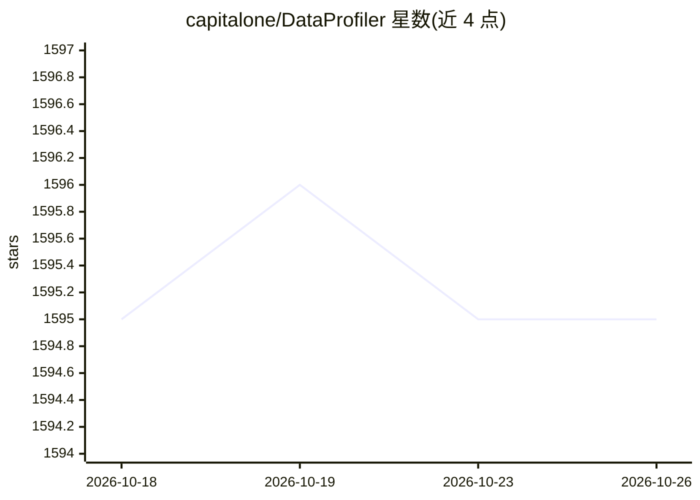

# capitalone/DataProfiler

⭐ 1,595 · Python · Apache-2.0 · 推送 2026-09-14 · [GitHub](https://github.com/capitalone/DataProfiler) · [官网](https://capitalone.github.io/DataProfiler) · 组织维护

**Python 数据画像库：分析数据集结构、统计信息并检测敏感数据**

DataProfiler 是由 Capital One 维护的 Python 库，用单条命令加载 CSV/JSON/Avro/Parquet/文本/Pandas DataFrame 等格式数据，自动生成数据画像：结构化数据给出 schema、列级统计（min/max/分位数/直方图/基尼不纯度等），非结构化文本给出词表统计，图数据给出节点边分布。内置预训练深度学习模型识别敏感数据（PII/NPI），可标注 BAN、信用卡、SSN、邮箱等约 20 类实体，支持新增实体或替换整个识别管线。提供 pypi 安装，含 full/ml/reports 多种依赖档位。

## 筛选速览

| 维度 | 判定 | 备注 |
|---|---|---|
| AI 角色 | `ai-native` | 本体是模型或模型工具 |
| 许可风险 | `permissive` | Apache-2.0 |
| 部署形态 | `library` | 以包/库形式分发 |
| 模型依赖 | — | README 未给出锁定关系 |
| 硬件要求 | — | 无带数字的原话,不猜 |
| 安装摩擦 | `low` | 无编译、无系统依赖或容器化 |
| 成熟度 | — | 结构信号不足 |

## 能力要点

- 单命令加载多格式数据并自动生成结构化/非结构化/图数据画像
- 预训练深度学习模型识别敏感数据（PII/NPI），支持约 20 类实体标签
- 可向现有模型添加新实体或插入全新实体识别管线
- 提供 full/ml/reports 多种 pip 安装档位，可避开 tensorflow

## 适用场景

- 数据科学工作流中快速了解数据集的 schema 与统计分布
- 扫描数据集中的 PII/NPI 敏感信息以满足合规需求
- 为下游应用或报告输出标准化的数据画像字典

## 场景标签

`数据分析` · 领域:效率与自动化

## 证据(README 行号)

> L22: Note: The Data Profiler comes with a pre-trained deep learning model, used to efficiently identify **sensitive data
> L10: The DataProfiler is a Python library designed to make data analysis, monitoring, and **sensitive data detection** e

## 星数曲线

2026-10-18 1,595 → 2026-10-26 1,595（+0）

---
*卡片 v1 · prompt 1.4 · 生成 2026-10-21 · 置信度 high · 依据 README sha `43ef598cac74` · [字段定义](../../DATASET.md)*
