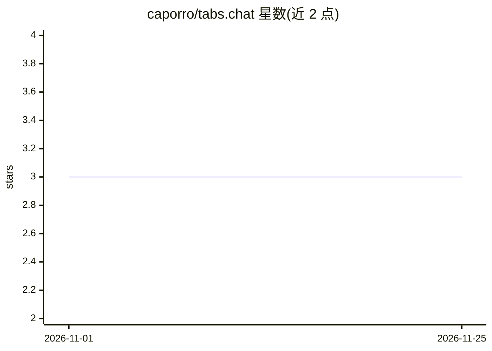

# caporro/tabs.chat

⭐ 3 · JavaScript · MIT · 推送 2026-10-29 · [GitHub](https://github.com/caporro/tabs.chat) · [官网](https://tabs.chat) · 个人维护

**浏览器内私有 AI 工作台：连云端/本地模型与 MCP 工具**

tabs.chat 是完全运行在浏览器中的 AI 聊天工作台，可连接云模型（OpenAI、Claude、Gemini）或本地服务（Ollama、LM Studio、OpenAI 兼容端点），将连接、指令、MCP 工具组织为 agent，并通过密码保护的链接共享配置。提供 Normal 与 Lite 两种单文件 HTML 便携版，无需账号或后端；数据存于浏览器 localStorage，密钥不加密。MCP 支持有限制，处于 Beta 状态，PWA 安装尚在计划中。

## 筛选速览

| 维度 | 判定 | 备注 |
|---|---|---|
| AI 角色 | `ai-native` | 本体是模型或模型工具 |
| 许可风险 | `permissive` | MIT |
| 部署形态 | `None` |  |
| 模型依赖 | local-ok | 支持本地模型 |
| 硬件要求 | — | 无带数字的原话,不猜 |
| 安装摩擦 | `low` | 无编译、无系统依赖或容器化 |
| 成熟度 | `idea` | |

## 能力要点

- 单文件便携 HTML，无需安装、账号或应用后端
- 连接云端与本地模型：OpenAI/Claude/Gemini/Ollama/LM Studio/OpenAI 兼容端点
- MCP 工具、多轮工具执行与内置日期/计算器/网页抓取/笔记工具
- agent 配置可通过链接（可加密码）共享，也可由 AI agent 生成

## 适用场景

- 在浏览器中与云端或本地大模型对话并接入 MCP 工具
- 把常用 agent 配置通过链接分发给团队成员
- 不依赖后端、数据留在本地的私有聊天工作区

## 场景标签

`聊天机器人` · 领域:对话与助手

## 证据(README 行号)

> L7: Runs entirely in your browser, including as a single portable HTML file. No tabs.chat account or application backend
> L45: - **Cloud and local models:** OpenAI, Anthropic Claude, Google Gemini, Ollama, LM Studio and OpenAI-compatible endp

## 星数曲线

2026-11-01 3 → 2026-11-25 3（+0）

---
*卡片 v1 · prompt 1.4 · 生成 2026-11-22 · 置信度 high · 依据 README sha `6c4418bd9527` · [字段定义](../../DATASET.md)*
