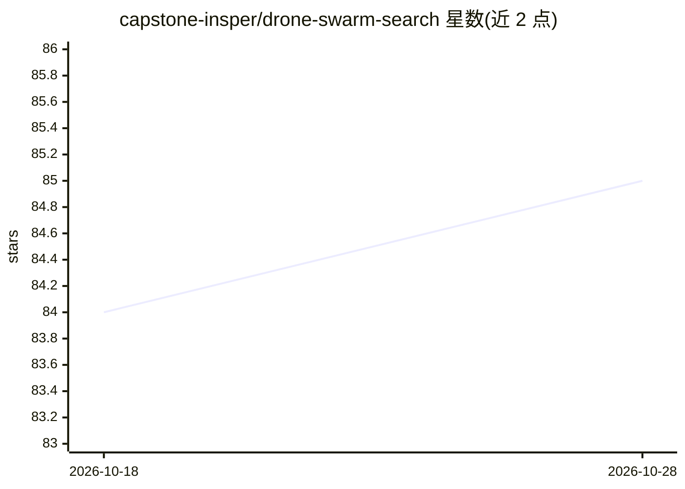

# capstone-insper/drone-swarm-search

⭐ 85 · Python · MIT · 推送 2026-08-31 · [GitHub](https://github.com/capstone-insper/drone-swarm-search) · [官网](https://capstone-insper.github.io/drone-swarm-search/) · 组织维护

**面向无人机集群搜救的多智能体强化学习仿真环境库**

基于 PettingZoo 构建的多智能体强化学习环境库，提供两类环境：一是海难幸存者搜救环境，用动态概率矩阵建模海面上人员的漂移，无人机集群以定位目标为目标；二是覆盖搜索环境，借助 Opendrift 的拉格朗日粒子仿真引入真实海洋与风力数据生成概率矩阵，无人机需在最短时间内覆盖搜索区域并优先高概率区域。以 Python 包发布于 PyPI，供科研人员与开发者开发、测试搜索策略，含文档站点、测试套件与 JOSS 论文 DOI。

## 筛选速览

| 维度 | 判定 | 备注 |
|---|---|---|
| AI 角色 | `ai-ecosystem` | LLM/agent 周边工具 |
| 许可风险 | `permissive` | MIT |
| 部署形态 | `library` | 以包/库形式分发 |
| 模型依赖 | — | README 未给出锁定关系 |
| 硬件要求 | — | 无带数字的原话,不猜 |
| 安装摩擦 | `low` | 无编译、无系统依赖或容器化 |
| 成熟度 | — | 结构信号不足 |

## 能力要点

- 搜救环境用动态概率矩阵建模海面人员漂移
- 覆盖环境基于 Opendrift 引入真实海洋与风力数据
- 基于 PettingZoo 接口的多智能体环境
- 提供测试套件（Pytest）与文档站点

## 适用场景

- 开发和比较多智能体强化学习的无人机搜救策略
- 在含真实海洋风力数据的仿真中测试区域覆盖算法
- 作为 MARL 研究的基准环境并引用其 JOSS 论文

## 场景标签

`强化学习` `科研工具` · 领域:学习与行业

## 证据(README 行号)

> L13: Welcome to the official GitHub repository for the Drone Swarm Search Environment (DSSE). This project offers a comp
> L15: In this repository, we have implemented two distinct types of environments. The first is a dynamic environment that

## 星数曲线

2026-10-18 84 → 2026-10-28 85（+1）

---
*卡片 v1 · prompt 1.4 · 生成 2026-10-24 · 置信度 high · 依据 README sha `e32d80e83da9` · [字段定义](../../DATASET.md)*
