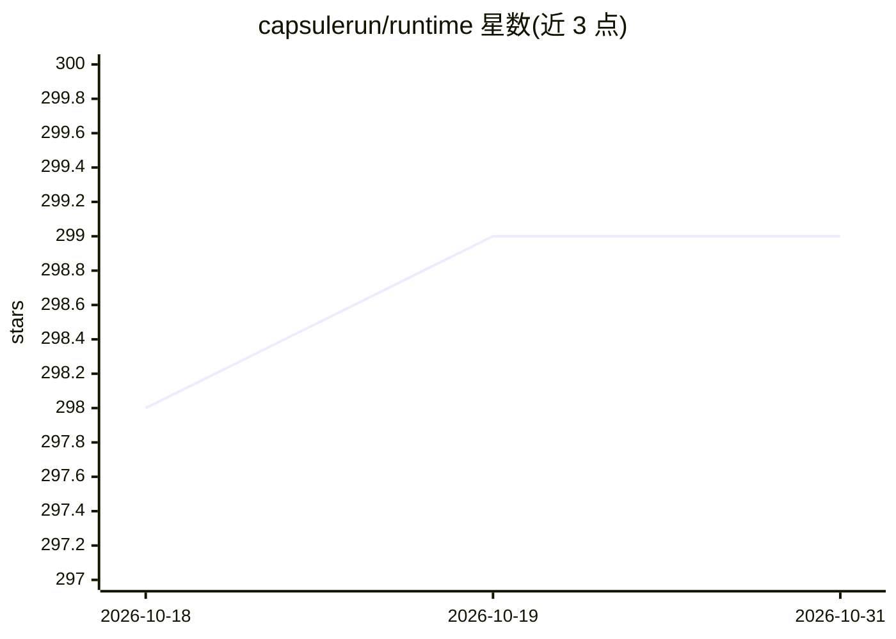

# capsulerun/runtime

⭐ 299 · Rust · Apache-2.0 · 推送 2026-10-12 · [GitHub](https://github.com/capsulerun/runtime) · 组织维护

**WebAssembly 沙箱运行时：安全执行不可信代码任务**

基于 Rust 的运行时，将每个任务编译为 WebAssembly 模块在隔离沙箱中执行，提供按任务的 CPU/内存/超时限制、网络域名白名单（allowed_hosts）、文件路径读写权限控制、目录挂载与环境变量注入。面向需要执行 AI agent 生成或不可信代码的场景，提供 Python（pip）与 TypeScript/JavaScript（npm）SDK 及 CLI，支持 capsule build 预编译为 .wasm 以降低首次调用延迟，也可从源码用 cargo 构建安装。

## 筛选速览

| 维度 | 判定 | 备注 |
|---|---|---|
| AI 角色 | `ai-ecosystem` | LLM/agent 周边工具 |
| 许可风险 | `permissive` | Apache-2.0 |
| 部署形态 | `library` | 以包/库形式分发 |
| 模型依赖 | — | README 未给出锁定关系 |
| 硬件要求 | — | 无带数字的原话,不猜 |
| 安装摩擦 | `low` | 无编译、无系统依赖或容器化 |
| 成熟度 | — | 结构信号不足 |

## 能力要点

- 每任务独立 Wasm 沙箱，可设 CPU/内存/超时/重试限制
- 网络白名单（allowed_hosts）与文件读写权限（allowed_files）
- 目录挂载与 capsule.toml 项目级默认配置
- capsule build 预编译 .wasm 并用 capsule exec 直接执行

## 适用场景

- 为 AI agent 生成的代码提供隔离执行环境
- 构建代码解释器或 serverless 任务执行服务
- 对第三方提交的脚本做资源与网络受限运行

## 场景标签

`Agent 框架` · 领域:Agent 开发

## 证据(README 行号)

> L7: ```Capsule``` is a runtime for executing untrusted code in isolated environments. Each task runs inside its own WebA
> L110:  return eval(code)

## 星数曲线



2026-10-18 298 → 2026-10-31 299（+1）


---
*卡片 v1 · prompt 1.4 · 生成 2026-10-22 · 置信度 high · 依据 README sha `479941bcde0a` · [字段定义](../../DATASET.md)*
