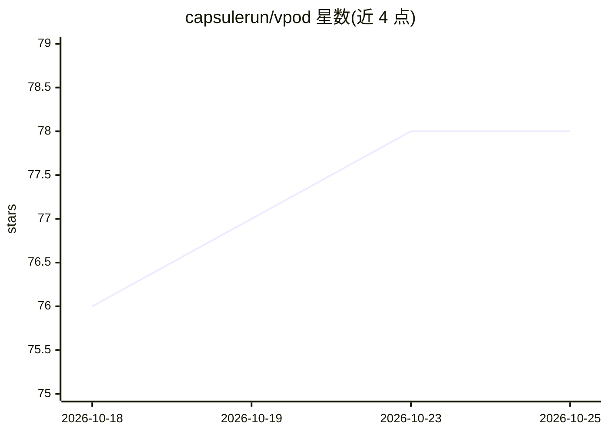

# capsulerun/vpod

⭐ 78 · Rust · Apache-2.0 · 推送 2026-10-06 · [GitHub](https://github.com/capsulerun/vpod) · [官网](https://docs.vpod.sh/) · 组织维护

**面向不可信代码的轻量 Linux 沙箱：浏览器与服务器均可运行**

基于 WebAssembly 的便携式沙箱：在 WASM 内运行完整 RISC-V (RV64GC) 系统并启动真实 Linux 内核与用户空间，用于隔离执行不可信进程。通过快照恢复实现亚秒级启动，支持挂起/恢复；采用 AOT 翻译热点路径提升 CPU 密集性能（约 5 倍），宿主仅经 WASI 0.2 边界暴露显式挂载目录与出站 socket。提供 TypeScript、Python SDK 与 CLI，可在浏览器标签页运行。限制：全部指令为模拟执行，无 GPU 访问，未实现 RVV 向量扩展。

## 筛选速览

| 维度 | 判定 | 备注 |
|---|---|---|
| AI 角色 | `ai-ecosystem` | LLM/agent 周边工具 |
| 许可风险 | `permissive` | Apache-2.0 |
| 部署形态 | `self-host` | docker 或自建部署 |
| 模型依赖 | — | README 未给出锁定关系 |
| 硬件要求 | — | 无带数字的原话,不猜 |
| 安装摩擦 | `low` | 无编译、无系统依赖或容器化 |
| 成熟度 | — | 结构信号不足 |

## 能力要点

- WASM 内运行 RISC-V Linux 完整系统，快照恢复亚秒级启动
- AOT 翻译热点代码路径，CPU 密集任务约 5 倍提升
- 通过 WASI 0.2 边界隔离：显式挂载目录、用户态网络栈
- 同一包支持浏览器（origin-private storage 缓存）与服务器

## 适用场景

- 为 AI agent 提供隔离的代码执行环境
- 在浏览器中运行不可信的 shell/工具调用
- 沙箱暂停后跨进程恢复执行状态
- 从自定义 Dockerfile 构建带 numpy/pandas 等依赖的快照

## 场景标签

 · 领域:代码沙箱/运行时基础设施

## 证据(README 行号)

> L14: A `vpod` is a lightweight, portable sandbox that gives an untrusted process an instant Linux environment. It uses a
> L28: **The WASI boundary.** The WASM component talks to the host exclusively through WASI 0.2. The guest never sees host

## 星数曲线

2026-10-18 76 → 2026-10-25 78（+2）

---
*卡片 v1 · prompt 1.4 · 生成 2026-10-24 · 置信度 mid · 依据 README sha `f1eece8ebb6a` · [字段定义](../../DATASET.md)*
