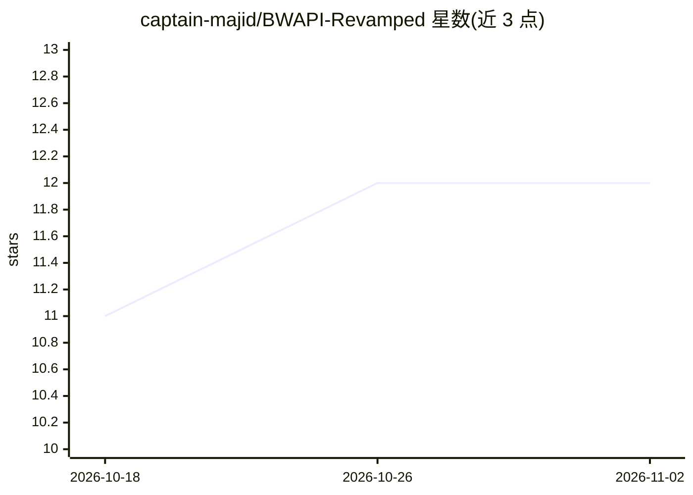

# captain-majid/BWAPI-Revamped

⭐ 12 · 推送 2026-03-11 · [GitHub](https://github.com/captain-majid/BWAPI-Revamped) · 个人维护

**给玩家的 BWAPI 一站式启动器：免配置人机对战 SC1 AI**

BWAPI Revamped 是围绕 BWAPI（星际争霸1 的用户自定义 AI 接口）打包的一站式 Windows 启动/整合包：解压后把 exe 放入 SC v1.16 目录、双击 ChaosLauncher 即可运行，免去传统 BWAPI 的复杂配置。功能包括离线对阵 AI、多 AI 互战观战、接管存档、多开游戏实例（8 个以上）、调速、CoachAI 练习与录像分析、SCR 热键一键导入等。BWAPI.dll 本体与常规安装相同，定位是集成与去繁的工具集。面向 SC1 玩家与 AI bot 开发者。

## 筛选速览

| 维度 | 判定 | 备注 |
|---|---|---|
| AI 角色 | `ai-ecosystem` | LLM/agent 周边工具 |
| 许可风险 | `none` | — |
| 部署形态 | `desktop` | 安装包/桌面程序 |
| 模型依赖 | — | README 未给出锁定关系 |
| 硬件要求 | — | 无带数字的原话,不猜 |
| 安装摩擦 | `low` | 无编译、无系统依赖或容器化 |
| 成熟度 | — | 结构信号不足 |

## 能力要点

- 解压+双击即用的 BWAPI 一站式启动整合包
- UDAI 对阵内置 AI、多 AI 互战观战、AI 接管存档
- 单机多开 8 个以上游戏实例并统一控制
- 内置 CoachAI：调速热键、练习与录像分析

## 适用场景

- 离线练习对战高难度 SC1 AI，指定开局策略
- 观看多个 AI bot 互战并暂停/调速分析
- 多开实例自测伤害机制等游戏细节

## 场景标签

 · 领域:游戏/游戏AI工具

## 证据(README 行号)

> L1: # BWAPI Revamped: Play w/ smarter SC1 AI
> L6: Unfortunately, some people still follow ancient methods dealing with BWAPI (the most viewed vid about BWAPI is very 
> L9: If you’re a player/developer, BWAPI Revamped should give you a comprehensive idea of what BWAPI can do, it has alot 

## 星数曲线

2026-10-18 11 → 2026-11-02 12（+1）

---
*卡片 v1 · prompt 1.4 · 生成 2026-11-01 · 置信度 high · 依据 README sha `d745e2c52464` · [字段定义](../../DATASET.md)*
