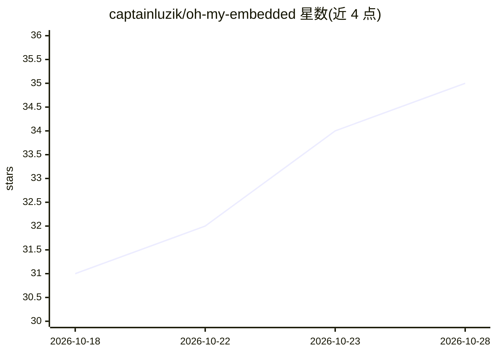

# captainluzik/oh-my-embedded

⭐ 35 · TypeScript · MIT · 推送 2026-03-04 · [GitHub](https://github.com/captainluzik/oh-my-embedded) · 个人维护

**面向嵌入式工程师的 OpenCode 插件：专业 agent、技能与计算工具**

作为 OpenCode 插件运行（可独立或与 oh-my-opencode 并用），为嵌入式工程师提供三类能力：@embedded/@hardware/@review-hw 三个专用 agent；按需加载的技能，每个技能自带 MCP 服务器（esp-mcp、kicad-mcp-server、@jlcpcb/mcp、GDB/serial、spicebridge），随技能启停；以及无需安装即可用的电池寿命、阻抗匹配、分压器、ESP32 引脚映射、去耦电容等计算工具。支持 /flash、/bom、/power-budget 等命令，并自动检测 ESP-IDF/PlatformIO/Zephyr/STM32CubeMX 项目类型注入上下文。插件本身无强制依赖，MCP 服务器按需安装；安装方式为让 LLM agent 按安装指南执行或从源码用 bun 构建。

## 筛选速览

| 维度 | 判定 | 备注 |
|---|---|---|
| AI 角色 | `ai-ecosystem` | LLM/agent 周边工具 |
| 许可风险 | `permissive` | MIT |
| 部署形态 | `library` | 以包/库形式分发 |
| 模型依赖 | — | README 未给出锁定关系 |
| 硬件要求 | — | 无带数字的原话,不猜 |
| 安装摩擦 | `low` | 无编译、无系统依赖或容器化 |
| 成熟度 | — | 结构信号不足 |

## 能力要点

- @embedded 与 @hardware 专用 agent 覆盖固件与 PCB/RF 工程
- 技能按需加载并自动启停各自的 MCP 服务器（KiCad、JLCPCB、GDB、ngspice 等）
- 内置 5 个常驻计算工具（功耗、阻抗、分压器、引脚映射、去耦电容）
- 自动检测 ESP-IDF/PlatformIO/Zephyr/STM32CubeMX 项目并注入上下文

## 适用场景

- 在终端里做 ESP32/STM32 固件开发、调试与代码评审
- KiCad PCB 设计、元件选型与生成 JLCPCB 物料清单
- 估算传感器节点电池寿命、做 RF 阻抗匹配等工程计算

## 场景标签

`编码 Agent` `代码审查` · 领域:编码与开发

## 证据(README 行号)

> L13: An OpenCode plugin for embedded engineers. It brings specialized agents, on-demand skills with MCP server integrati
> L52: Skills load on-demand via the `skill` tool. Each skill carries its own MCP servers — they start when you load the s

## 星数曲线

2026-10-18 31 → 2026-10-28 35（+4）

---
*卡片 v1 · prompt 1.4 · 生成 2026-10-25 · 置信度 mid · 依据 README sha `b9d36a33bbf1` · [字段定义](../../DATASET.md)*
