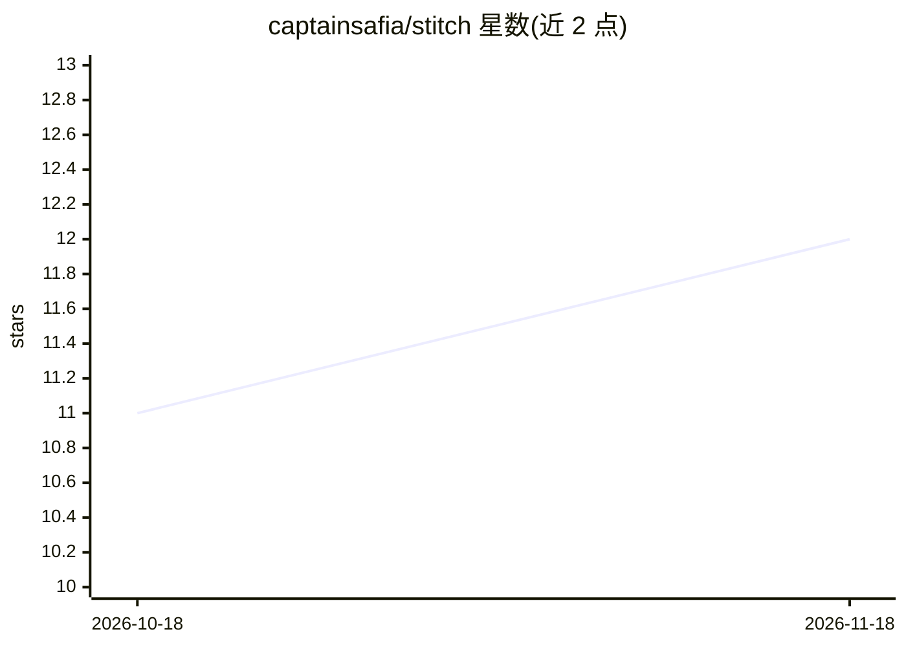

# captainsafia/stitch

⭐ 12 · TypeScript · MIT · 推送 2025-12-31 · [GitHub](https://github.com/captainsafia/stitch) · 个人维护

**为开发者与 agent 记录代码变更意图并绑定 git 的意图日志工具**

stitch 是一款意图追踪工具：用户或 AI agent 创建记录变更意图的 "stitch" 文档，将其链接到 git commit、commit 范围或暂存 diff 指纹，形成带父子层级与依赖关系的意图 DAG；提供 stitch blame 查看每行代码背后的意图。数据以 Markdown+TOML 形式存于仓库 .stitch/ 目录，可作 CLI 或 TypeScript 库使用，并通过 MCP server 以 9 个显式工具（无隐式状态）暴露给 MCP 兼容的 AI agent。安装方式为脚本下载二进制或 bun 编译源码。

## 筛选速览

| 维度 | 判定 | 备注 |
|---|---|---|
| AI 角色 | `ai-enhanced` | 去掉 AI 部分产品仍成立 |
| 许可风险 | `permissive` | MIT |
| 部署形态 | `None` |  |
| 模型依赖 | — | README 未给出锁定关系 |
| 硬件要求 | — | 无带数字的原话,不猜 |
| 安装摩擦 | `low` | 无编译、无系统依赖或容器化 |
| 成熟度 | — | 结构信号不足 |

## 能力要点

- 将意图文档链接到 commit、commit 范围与暂存 diff 指纹
- 带父子层级与依赖关系的意图 DAG
- stitch blame 显示每行代码对应的意图归属
- 内置 MCP server，以 9 个无状态工具供 AI agent 调用

## 适用场景

- 在使用 AI agent 写代码时记录每次改动的意图
- 按任务拆分子任务并追踪各子意图的实现进度
- 查看某行代码当初为何被修改

## 场景标签

 · 领域:开发者工具/版本控制辅助

## 证据(README 行号)

> L5: Stitch is a tool to help agents (and humans!) record their **intent** ("stitches") and bind it to **git commits/diff
> L15: - **MCP Server**: Expose stitch functionality to AI agents via the Model Context Protocol
> L186: Stitch includes an MCP (Model Context Protocol) server that allows AI agents to interact with stitch functionality

## 星数曲线

2026-10-18 11 → 2026-11-18 12（+1）

---
*卡片 v1 · prompt 1.4 · 生成 2026-11-18 · 置信度 high · 依据 README sha `3d56f6b4bbb0` · [字段定义](../../DATASET.md)*
